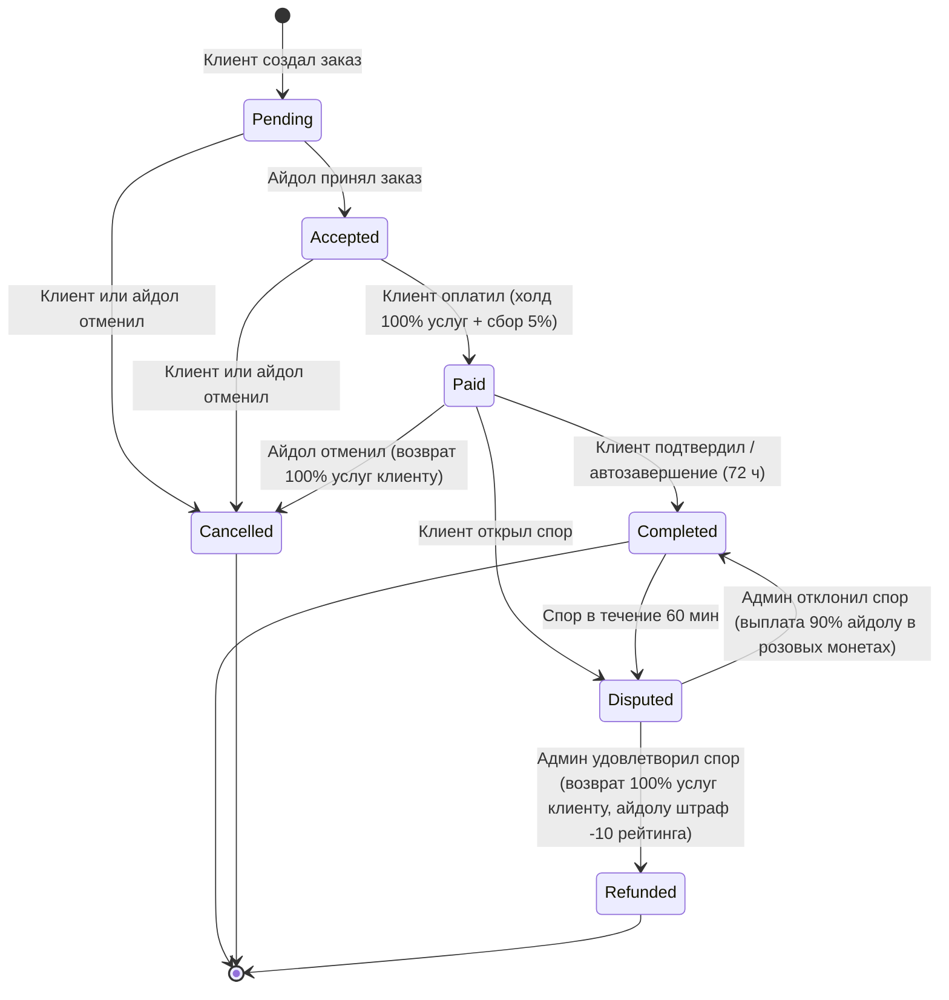

# Not Alone — Правила проекта, Архитектурные инварианты и Стандарты

> Данный документ является **единым источником правды (Single Source of Truth)** о бизнес-логике, архитектуре, финансовых правилах и стандартах разработки платформы Not Alone. Любой AI-агент или разработчик обязан руководствоваться этими правилами перед внесением изменений.

---

## 1. Главные правила разработки и инфраструктура

### 1.1. Запуск тестов и команд (КРИТИЧЕСКИЙ СТАНДАРТ)

* **Запуск dev-окружения:** dev-окружение запускается командой `composer run docker-dev` (или `bash docker-dev.sh`) на хост-машине. Эта команда поднимает полный стек Docker Compose (`app`, `db`, `redis`, `mailpit`, `reverb`, `worker`, `scheduler`, `vite`, `minio`), генерирует SSL-сертификаты под текущий локальный IP и настраивает сетевые переменные. Запускать контейнеры вручную по отдельности (`docker start not_alone_app` и т.п.) запрещено, так как это оставляет незапущенными сокеты (Reverb), хранилище медиа (MinIO) и фоновый воркер очередей.
* **ЗАПРЕЩЕНО** запускать `php`, `artisan`, `phpunit` или `pint` напрямую на хост-машине (на хосте отсутствует окружение и зависимости).
* **PHP-команды и тесты запускаются ИСКЛЮЧИТЕЛЬНО внутри Docker-контейнера:**

  ```bash
  # Запуск dev-окружения (на хосте):
  composer run docker-dev

  # Запуск всех тестов:
  docker exec not_alone_app php artisan test

  # Запуск конкретного теста:
  docker exec not_alone_app php artisan test tests/Feature/RefundCommissionDeductionTest.php

  # Миграции и сидеры:
  docker exec not_alone_app php artisan migrate
  docker exec not_alone_app php artisan db:seed

  # Форматирование кода (Pint):
  docker exec not_alone_app ./vendor/bin/pint
  ```

* **Чтение, поиск и работа с файлами (read_file, grep, find, git), а также сборка фронтенда (`npm run build`) выполняются ЛОКАЛЬНО на хост-машине.** Не нужно выполнять чтение или поиск файлов через `docker exec`.

### 1.2. Технологический стек

* **Бэкенд:** PHP 8.4.x, Laravel 11 (`v11.48+`).
* **База данных:** PostgreSQL 16 Alpine (порт хоста `5433`, внутри `5432`).
* **Кэш, Сессии, Очереди:** Redis Alpine (`SESSION_DRIVER=redis`, `QUEUE_CONNECTION=redis`, `CACHE_STORE=redis`).
* **Фронтенд:** Vue 3 (Composition API), Inertia.js v3 (`@inertiajs/vue3`), Vite 6, Tailwind CSS 3, Element Plus.
* **WebSockets / Realtime:** Laravel Reverb (порт `8080`).
* **S3 / Хранилище медиа:** MinIO (S3 API `9000`, консоль `8900`, bucket `not-alone`).
* **Dev Mail:** Mailpit (веб-интерфейс `8025`, SMTP `1025`).

### 1.3. Проверка UI в браузере

* Фронтенд-изменения проверяются на живой странице в реальном браузере (dev-сервер), а не только сборкой и типами.
* Состояние страницы снимается через **ariaSnapshot / observe** (accessibility-дерево / наблюдение за состоянием DOM). **Скриншоты не используются** как способ проверки.
* Все ожидания — с явным таймаутом **3–5 с** (не дефолтные 20–30 с): проверяемое состояние должно наблюдаться за это время, иначе проверка падает сразу.
* Критерий успеха — наблюдаемое состояние UI (видимые строки таблицы, значения полей, состояния элементов), а не отсутствие ошибок сборки.

---

## 2. Роли пользователей и матрица прав

| Роль | Модель / Guard | Права и ключевые особенности | Ограничения |
| --- | --- | --- | --- |
| **Клиент** | `User`<br>`is_idol = false` | Поиск айдолов, 1 бесплатный пробный заказ (Trial, 0 монет) на айдола, пополнение баланса (синие монеты), оплата заказов (синие монеты + сервисный сбор), диспуты, отзывы, покупка паков, рамки достижений. | ❌ **Вывод средств запрещён** (деньги остаются в кошельке платформы).<br>❌ **Прямая отмена оплаченного заказа запрещена** (только через диспут).<br>❌ Не может создавать платные услуги и паки.<br>❌ Розовые монеты скрыты и недоступны. |
| **Айдол** | `User`<br>`is_idol = true` | Все права клиента + отдельный заработанный счёт в **розовых монетах** (заказы, паки, вишлисты, донаты), получение рейтинга (0–100), создание услуг и паков, подтверждение выполнения заказов, вывод розовых монет на карту или конвертация 1:1 в синие монеты. | ❌ Цены услуг ограничены `ServicePriceLimit` (для рейтинга < 30 действует пониженный лимит).<br>❌ Запрещено покупать свои паки и заказывать у себя.<br>❌ Овердрафт розового счёта ограничен `-50 000.00`.<br>❌ Обратная конвертация из синих в розовые запрещена. |
| **Администратор** | `Admin`<br>guard: `admin` | Модерация заявок айдолов, услуг и паков, разрешение споров/диспутов, страйки (3 страйка = бан), финансовые корректировки, аудит логов с фиксацией IP/User-Agent, управление `PlatformSetting`. | ❌ Не участвует в сделках как клиент/айдол. |

---

## 3. Финансовая система, двухвалютная модель кошельков и эскроу (WalletService)

### 3.1. Двухвалютная модель (Синие и Розовые монеты)

* Все расчёты внутри платформы ведутся в монетах двух типов (вместо значка рубля отображаются иконки синей/розовой монеты; текстовое слово «монет» рядом с суммами не добавляется):
  * **Синие монеты (`balance`, `held_balance`):** потребительский баланс для оплаты услуг, контент-паков, вишлистов и донатов. Пополняется через платёжный шлюз (комиссия `deposit_fee_percent = 4.0%`). Вывод на карту запрещён. Клиенты видят **только синие монеты**.
  * **Розовые монеты (`pink_balance`, `pink_held_balance`):** заработанные средства айдола. Начисляются за выполненные заказы, продажу паков, донаты и вишлисты.
  * **Вывод средств (`withdraw`):** доступен **только айдолам** и списывается исключительно с доступного розового баланса (`pink_balance`). Комиссия на вывод: `withdrawal_fee_percent = 4.0%`.
  * **Конвертация (`convertPinkToBlue`):** айдол может конвертировать любую сумму доступных розовых монет в синие монеты по курсу 1:1 для покупок внутри платформы. Обратная конвертация (синие → розовые) строго запрещена.

### 3.2. Эскроу при оплате заказа и сервисный сбор клиента

1. **Сервисный сбор клиента:**
   * При оплате заказа клиент оплачивает стоимость услуг плюс сервисный сбор платформы: `order_customer_service_fee_percent = 5.0%` (настраивается в админке, 0–50%).
   * Сбор списывается с баланса клиента транзакцией `CustomerServiceFee` и является **невозвратным**.
2. **Оплата услуг (`holdOrderWithFee`):** 100% стоимости услуг перемещается из доступного синего баланса клиента в `held_balance` (`OrderHold`).
3. **Завершение (`releaseHold`):**
   * У клиента синий `held_balance` списывается до 0 (`OrderHoldRelease`).
   * Платформа удерживает базовую комиссию с айдола: `platform_fee_percent = 10.0%`.
   * Чистая выплата айдолу зачисляется в **розовый холд** `pink_held_balance` айдола на **60 минут** (`order_dispute_window_minutes`):
     $$\text{net\_payout} = \text{service\_amount} - 10\%$$
4. **Выплата айдолу (`releaseIdolPayout`):** по истечении 60 минут при отсутствии открытых споров средства переходят из `pink_held_balance` в доступный `pink_balance` айдола.

### 3.3. Возвраты средств (Refunds)

При отмене оплаченного заказа айдолом или одобрении спора администратором в пользу клиента:

* **СТРОГИЙ ИНВАРИАНТ:** Клиенту возвращается **100% стоимости услуг** обратно на его синий баланс (`balance`):
  $$\text{net\_refund} = \text{service\_amount}$$
* Невозвратный сервисный сбор клиента (5%) остаётся платформе.
* Если отменённый/возвращённый заказ являлся пробным (Trial), клиенту восстанавливается право на пробный заказ у данного айдола (`user_idol_trials`).
* Если спор одобрен до истечения 60 минут: чистая сумма выплаты списывается из `pink_held_balance` айдола.
* Если спор одобрен после 60 минут: выплата списывается с доступного баланса айдола (`pink_balance`) через `OrderClawback`. При этом айдолу начисляется штраф рейтинга (по умолчанию **-10.0**, настраивается в админке: `rating_delta_order_refunded`).

### 3.4. Овердрафт айдола и защита возврата клиенту

* Списание `OrderClawback` может уводить `pink_balance` айдола в минус в пределах констрейнта PostgreSQL: `CHECK (pink_balance >= -50000.00)`.
* При балансе $\le -40\,000.00$ логируется критический алерт (`CRITICAL_OVERDRAFT_THRESHOLD`).
* **Защита клиента:** Если баланс айдола достигает предела `-50 000.00`, клиент гарантированно получает свой 100% возврат за услуги, а разницу покрывает платформа.

### 3.5. Идемпотентность

* Каждая транзакция кошелька имеет `idempotency_key` с уникальным индексом `UNIQUE`.
* Повторный вызов с тем же ключом валидирует совпадение параметров и мягко возвращает созданную транзакцию без дублирования списаний/начислений.

---

## 4. Жизненный цикл заказов (Order Lifecycle)



### 4.1. Правила отмены и подтверждения

* **Клиент:** может отменить заказ **только до оплаты** (`pending`, `accepted`). После оплаты прямая отмена заблокирована — только открытие спора (`Disputed`).
* **Айдол:** может отменить в статусах `pending`, `accepted` и `paid` (при отмене оплаченного клиенту начисляется 100% возврат стоимости услуг; сервисный сбор 5% остаётся платформе).
* **Завершение:** подтверждение со стороны клиента мгновенно завершает заказ. Если подтвердил только айдол — запускается ожидание клиента либо автозавершение через **72 часа** (`order_auto_complete_delay`).
* **Пробные заказы (Trial):** 0 монет, строго `quantity = 1`, доступен 1 раз для каждого айдола (учёт в `user_idol_trials`). При отмене/возврате trial-заказа право на пробный заказ восстанавливается.

### 4.2. Лимиты цен на услуги (ServicePriceLimit)

* Лимиты привязаны к категориям `ServiceCategory`.
* Поля: `max_price` (общий потолок) и `low_rating_max_price` (пониженный потолок для рейтинга айдола $< 30$).
* Сохранение цены услуги выше разрешённого лимита блокируется валидацией.

---

## 5. Система рейтинга айдолов (IdolRatingService)

### 5.1. Базовые правила

* Рейтинг формируется **только у айдолов** (`is_idol = true`), диапазон **0.00 – 100.00**, старт при создании: **20.00**.
* Порог «низкого рейтинга»: **30.00** (`rating_low_threshold`). При падении ниже 30 айдол получает предупреждение и ограничение цен на услуги.

### 5.2. Таблица событий и дельт

| Событие | Дельта | Триггер |
| --- | :---: | --- |
| `review_5star` | **+0.8** | Отзыв клиента 5★ |
| `review_4star` | **+0.4** | Отзыв клиента 4★ |
| `review_3star` | **0.0** | Отзыв клиента 3★ (нейтральный) |
| `review_2star` | **-0.5** | Отзыв клиента 2★ |
| `review_1star` | **-1.2** | Отзыв клиента 1★ |
| `order_completed` | **+0.2** | Заказ успешно выполнен |
| `order_refunded` | **-10.0** | Заказ аннулирован с возвратом средств клиенту по диспуту (настраивается в админке) |
| `report_accepted` | **-2.0** | Жалоба на айдола подтверждена администратором |
| `review_dispute_approved` | Симметричный откат | Спор по отзыву удовлетворён администратором (отзыв скрыт): +1.2 (1★), +0.5 (2★), 0.0 (3★), -0.4 (4★), -0.8 (5★) без демпфирования |
| `strike` | -0.1 .. -1.0 | Страйк от администратора |
| `strike_cancelled` | +0.1 .. +1.0 | Полный возврат списанного за страйк рейтинга при отмене |
| `admin_manual` | Произвольная | Ручная корректировка администратором с комментарием |

### 5.3. Формула асимптотики (Dampening)

Применяется **только к положительным дельтам** (чем выше текущий рейтинг, тем медленнее он растёт):
$$\text{effectiveDelta} = \max\left(0.01,\, \text{round}\left(\text{baseDelta} \times \frac{100 - \text{currentRating}}{80},\, 2\right)\right)$$
*Отрицательные дельты (штрафы) и откаты рейтинга при диспутах отзывов применяются в полном размере без изменений.*

### 5.4. Защита от накрутки и правила отзывов

* Уникальный индекс `(reviewer_id, idol_id)` в `reviews` — максимум один отзыв на пару.
* Отзыв разрешён только к завершённому заказу (`status = completed`).
* Строгий запрет ссылок (`NoLinksRule`) и мат-фильтр на русском и английском языках (`NoProfanityRule`).
* Айдол может оспаривать отзывы с **любым количеством звёзд (1–5★)** (до 2 попыток на отзыв).
* Посты в ленте, лайки и комментарии на рейтинг не влияют.
* Все изменения пишутся в журнал `idol_rating_logs`.

---

## 6. Контент-паки (Content Packs)

* Создаются только айдолами. Стоимость: от `100 ₽` до `10 000 ₽`.
* Новые паки проходят пре-модерацию администратором (`moderate_new_packs = 1`).
* Редактирование опубликованных паков происходит через `ContentPackChangeRequest`.
* Покупка: защита от покупки собственных паков и повторной покупки одного и того же пака.
* Комиссия платформы: `platform_fee_percent = 10.0%`. Автор получает 90% сразу на доступный баланс.

---

## 7. Аватарки и рамки достижений (AvatarFrames)

* **Типы рамок:** `free` (бесплатные), `paid` (покупка за рубли), `achievement` (автоматическая разблокировка за достижения).
* **Условия достижений (`ConditionRegistry`):** выполненные заказы (10, 25, 50, 100), заработок (10k, 100k ₽), высокий рейтинг (40, 50), отзывы (50), продажи паков, посты, подписчики.
* **Экипировка:** поле `users.active_frame_id`. Пользователь может надеть/снять любую открытую рамку.

---

## 8. Карта ключевых файлов проекта

* **Финансы и кошельки:**
  * Сервис: `app/Services/WalletService.php`
  * Модели: `app/Models/Wallet.php`, `app/Models/WalletTransaction.php`
  * Перечисления: `app/Enums/WalletTransactionType.php`
  * Контроллер: `app/Http/Controllers/WalletController.php`
* **Заказы и услуги:**
  * Сервисы: `app/Services/OrderService.php`, `app/Services/IdolRatingService.php`
  * Модели: `app/Models/Order.php`, `app/Models/OrderItem.php`, `app/Models/Service.php`, `app/Models/ServiceCategory.php`, `app/Models/ServicePriceLimit.php`
  * Перечисления: `app/Enums/OrderStatus.php`
  * Контроллеры: `app/Http/Controllers/OrderController.php`, `app/Http/Controllers/ServiceController.php`
* **Админка и настройки:**
  * Контроллеры: `app/Http/Controllers/Admin/PlatformSettingsController.php`, `app/Http/Controllers/Admin/TransactionController.php`, `app/Http/Controllers/Admin/DisputeController.php`, `app/Http/Controllers/Admin/OrderController.php`
  * Модель настроек: `app/Models/PlatformSetting.php`
  * Фронтенд настроек: `resources/js/Pages/Admin/Settings.vue`
* **Контент-паки и рамки:**
  * Паки: `app/Models/ContentPack.php`, `app/Http/Controllers/ContentPackPurchaseController.php`
  * Рамки: `app/Models/AvatarFrame.php`, `app/Services/AvatarFrames/ConditionRegistry.php`

---

## 9. Сводная таблица параметров системы (`PlatformSetting`)

| Ключ | Дефолт | Описание |
| --- | :---: | --- |
| `deposit_fee_percent` | `4.0%` | Комиссия на пополнение кошелька |
| `withdrawal_fee_percent` | `4.0%` | Комиссия на вывод средств (только айдолы) |
| `platform_fee_percent` | `10.0%` | Базовая комиссия платформы со сделок и паков |
| `order_customer_service_fee_percent` | `5.0%` | Невозвратный сервисный сбор с клиента при оплате заказа |
| `refund_gateway_fee_percent` | `4.0%` | Невозвратная комиссия платёжной системы при возврате |
| `refund_platform_fee_percent` | `10.0%` | Невозвратная комиссия платформы при возврате |
| `order_dispute_window_minutes` | `60` мин | Окно холда выплаты айдолу и подачи спора клиентом |
| `order_auto_complete_delay` | `72.0` ч | Время автозавершения заказа после подтверждения айдолом |
| `rating_low_threshold` | `30` | Порог низкого рейтинга айдола |
| `content_pack_price_min` | `100` монет | Минимальная цена контент-пака |
| `content_pack_price_max` | `10 000` монет | Максимальная цена контент-пака |
| `moderate_new_packs` | `1` | Пре-модерация новых контент-паков |
| `rating_delta_review_5star` | `+0.8` | Дельта рейтинга за отзыв 5★ |
| `rating_delta_review_4star` | `+0.4` | Дельта рейтинга за отзыв 4★ |
| `rating_delta_review_2star` | `-0.5` | Дельта рейтинга за отзыв 2★ |
| `rating_delta_review_1star` | `-1.2` | Дельта рейтинга за отзыв 1★ |
| `rating_delta_order_completed` | `+0.2` | Дельта рейтинга за успешный заказ |
| `rating_delta_order_refunded` | `-10.0` | Штраф рейтинга айдолу при возврате заказа по диспуту |
| `rating_delta_report_accepted` | `-2.0` | Штраф рейтинга за подтверждённую жалобу |
| `rating_delta_review_dispute_approved` | Симметричный откат | Откат начисленного/списанного рейтинга за скрытый отзыв |
