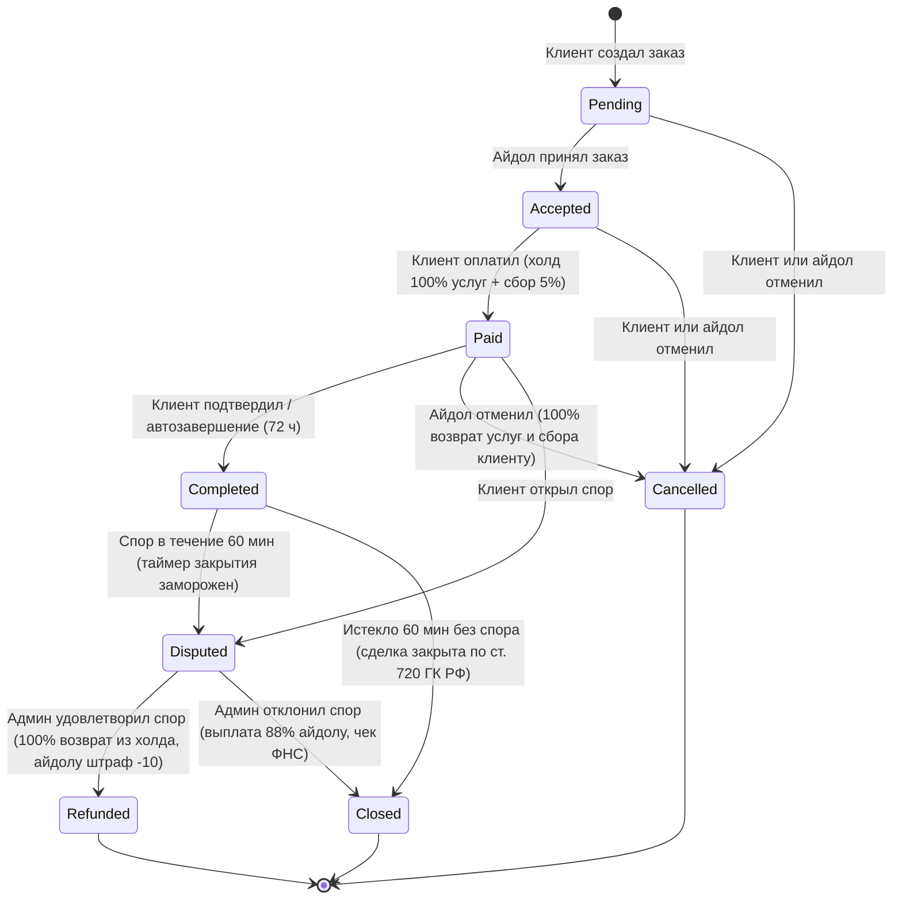

# Not Alone — Правила проекта, Архитектурные инварианты и Стандарты

> Данный документ является **единым источником правды (Single Source of Truth)** о бизнес-логике, архитектуре, финансовых правилах и стандартах разработки платформы Not Alone. Любой AI-агент или разработчик обязан руководствоваться этими правилами перед внесением изменений.

---

## 1. Главные правила разработки и инфраструктура

### 1.1. Запуск тестов и команд (КРИТИЧЕСКИЙ СТАНДАРТ)

* **Запуск dev-окружения:** dev-окружение запускается командой `composer run docker-dev` (или `bash docker-dev.sh`) на хост-машине. Эта команда поднимает полный стек Docker Compose (`app`, `db`, `redis`, `mailpit`, `reverb`, `worker`, `scheduler`, `vite`, `minio`), генерирует SSL-сертификаты под текущий локальный IP и настраивает сетевые переменные. Запускать контейнеры вручную по отдельности (`docker start not_alone_app` и т.п.) запрещено, так как это оставляет незапущенными сокеты (Reverb), хранилище медиа (MinIO) и фоновый воркер очередей.
* **ЗАПРЕЩЕНО** запускать `php`, `artisan`, `phpunit` или `pint` напрямую на хост-машине (на хосте отсутствует окружение и зависимости).
* **PHP-команды и тесты запускаются ИСКЛЮЧИТЕЛЬНО внутри Docker-контейнера:**

  ```bash
  # Запуск dev-окружения (на хосте):
  composer run docker-dev

  # Запуск всех тестов:
  docker exec not_alone_app php artisan test

  # Запуск конкретного теста:
  docker exec not_alone_app php artisan test tests/Feature/FinancialArchitectureTest.php

  # Миграции и сидеры:
  docker exec not_alone_app php artisan migrate
  docker exec not_alone_app php artisan db:seed

  # Форматирование кода (Pint):
  docker exec not_alone_app ./vendor/bin/pint
  ```

* **Чтение, поиск и работа с файлами (read_file, grep, find, git), а также сборка фронтенда (`npm run build`) выполняются ЛОКАЛЬНО на хост-машине.** Не нужно выполнять чтение или поиск файлов через `docker exec`.

### 1.2. Технологический стек

* **Бэкенд:** PHP 8.4.x, Laravel 11 (`v11.48+`).
* **База данных:** PostgreSQL 16 Alpine (порт хоста `5433`, внутри `5432`).
* **Кэш, Сессии, Очереди:** Redis Alpine (`SESSION_DRIVER=redis`, `QUEUE_CONNECTION=redis`, `CACHE_STORE=redis`, выделенная платёжная очередь `payments`).
* **Фронтенд:** Vue 3 (Composition API), Inertia.js v3 (`@inertiajs/vue3`), Vite 6, Tailwind CSS 3, Element Plus.
* **WebSockets / Realtime:** Laravel Reverb (порт `8080`).
* **S3 / Хранилище медиа и документов:** MinIO (S3 API `9000`, консоль `8900`, bucket `not-alone`, сервера строго в РФ по 152-ФЗ).
* **Платёжный провайдер / BaaS:** Финтех-платформа Mandarin (mandarin.io) — **BaaS (Banking-as-a-Service)** на базе **Номинального счёта (ст. 860.1 ГК РФ)**, выплаты по СБП (B2C), автоматическая фискализация в ФНС РФ «Мой налог» (422-ФЗ) и онлайн-касса (54-ФЗ).
* **Dev Mail:** Mailpit (веб-интерфейс `8025`, SMTP `1025`).

### 1.3. Проверка UI в браузере

* Фронтенд-изменения проверяются на живой странице в реальном браузере (dev-сервер), а не только сборкой и типами.
* Состояние страницы снимается через **ariaSnapshot / observe** (accessibility-дерево / наблюдение за состоянием DOM). **Скриншоты не используются** как способ проверки.
* Все ожидания — с явным таймаутом **3–5 с** (не дефолтные 20–30 с): проверяемое состояние должно наблюдаться за это время, иначе проверка падает сразу.
* Критерий успеха — наблюдаемое состояние UI (видимые строки таблицы, значения полей, состояния элементов), а не отсутствие ошибок сборки.

---

## 2. Роли пользователей и матрица прав

| Роль | Модель / Guard | Права и ключевые особенности | Ограничения |
| --- | --- | --- | --- |
| **Клиент** | `User`<br>`is_idol = false` | Поиск айдолов, 1 бесплатный пробный заказ (Trial, 0 🪙) на айдола, пополнение баланса фиксированными пакетами `CoinPack` (синие монеты), оплата заказов (синие монеты + сервисный сбор 5%), диспуты (окно 60 мин), отзывы, покупка паков, рамки достижений. | ❌ **Вывод средств запрещён** (кнопка вывода отсутствует во исполнение 115-ФЗ; возврат неиспользованного аванса — только заявительно по ст. 32 ЗОЗПП на исходную карту).<br>❌ **Прямая отмена оплаченного заказа запрещена** (только через диспут).<br>❌ Не может создавать платные услуги и паки.<br>❌ Розовые монеты скрыты и недоступны. |
| **Айдол** | `User`<br>`is_idol = true` | Все права клиента + отдельный заработанный счёт в **розовых монетах** (`pink_balance`, в концепции `earnings_balance`), получение рейтинга (0–100), создание услуг и паков, подтверждение выполнения заказов, еженедельный автовывод по СБП (0% комиссия) или конвертация 1:1 в синие монеты. | ❌ Вывод средств доступен **только плательщикам НПД (самозанятым гражданам РФ по 422-ФЗ)** с привязанным ИНН и реквизитами СБП.<br>❌ Цены услуг ограничены `ServicePriceLimit` (для рейтинга < 30 действует пониженный лимит).<br>❌ Запрещено покупать свои паки и заказывать у себя.<br>❌ **Овердрафт строго запрещён:** инвариант `pink_balance >= 0.00`.<br>❌ Обратная конвертация из синих в розовые запрещена. |
| **Администратор** | `Admin`<br>guard: `admin` | Модерация заявок айдолов, услуг и паков, разрешение споров/диспутов, страйки (3 страйка = бан), принудительный вывод остатка (< 1 000 ₽) при закрытии профиля айдола с кулдауном 365 дней, аудит логов с фиксацией IP/User-Agent, управление `PlatformSetting`. | ❌ Не участвует в сделках как клиент/айдол.<br>❌ Запрещены ручные финансовые корректировки без реального пополнения номинального счёта. |

---

## 3. Финансовая система, двухвалютная модель кошельков и Mandarin BaaS (WalletService)

### 3.1. Двухвалютная модель и пакеты монет (CoinPack)

* В интерфейсе Not Alone суммы отображаются в виде **монет** (`1 000 🪙`, синие монеты для клиентов и розовые монеты для заработка айдолов).
* Во исполнение ст. 10 ЗОЗПП и ст. 317 п. 2 ГК РФ рядом с монетами обязательно указывается рублёвый эквивалент: `1 000 🪙 (1 000 ₽)`. Монета является внутренней учётной единицей, строго эквивалентной рублю РФ:
  $$\mathbf{1\text{ монета}} = \mathbf{1.00\text{ рубль РФ (RUB)}}$$
* **Потребительский счёт (`balance`, `held_balance`):** Синие монеты для оплаты услуг, контент-паков и донатов.
  * Пополнение осуществляется **исключительно фиксированными пакетами `CoinPack`** (разовый стартер-пак `300 ₽`, регулярные `500 ₽`, `700 ₽`, `1 000 ₽`).
  * Комиссия на пополнение: `deposit_fee_percent = 0.0%` (эквайринг Mandarin полностью покрывает платформа из своей маржи). Покупатель получает ровно 1 монету за 1 внесённый рубль.
  * На чекауте при нехватке монет вызывается модалка `SuggestPackModal.vue`, предлагающая минимальный подходящий пакет.
  * Свободный вывод средств клиентами категорически заблокирован (115-ФЗ). Возврат неиспользованного аванса (Refund по ст. 32 ЗОЗПП) осуществляется через обращение в поддержку строго на исходную банковскую карту/счёт СБП в срок до 10 дней.
* **Заработанный счёт (`pink_balance`, `pink_held_balance`):** Розовые монеты (заработок айдола в концепции `earnings_balance`).
  * Начисляются за выполненные заказы, продажу паков и донаты.
  * **Вывод средств (`withdraw`):** Доступен **только айдолам со статусом самозанятого (422-ФЗ)**. Выплаты производятся еженедельно по понедельникам (06:00 UTC) пакетом от `1 000.00 ₽` (`payout_min_threshold`) строго через Систему быстрых платежей (СБП) с номинального счёта.
  * **Комиссия на вывод: `0.0%` (0.00 ₽)** — все банковские расходы покрывает платформа.
  * **Конвертация (`convertPinkToBlue`):** Айдол может в любой момент конвертировать доступные розовые монеты в синие по курсу 1:1 для личных покупок без комиссии. Обратная конвертация (синие → розовые) категорически заблокирована.

### 3.2. Эскроу при оплате заказа, сервисный сбор и комиссия платформы

1. **Сервисный сбор клиента:**
   * При оплате заказа клиент оплачивает стоимость услуг плюс сервисный сбор платформы: `order_customer_service_fee_percent = 5.0%`.
   * Сбор списывается с синего баланса клиента и фискализируется чеком онлайн-кассы платформы по 54-ФЗ («Полный расчёт с зачётом аванса»).
   * Сбор является невозвратным при добровольном отказе клиента от надлежаще исполненного заказа, но **компенсируется в размере 100%** (с чеком 54-ФЗ «Возврат прихода») при отмене заказа по вине айдола или удовлетворении спора арбитражем.
2. **Оплата услуг (`holdOrderWithFee`):** 100% стоимости услуг (`service_amount`) перемещается из доступного синего баланса в `held_balance`.
3. **Завершение (`releaseHold`):**
   * При подтверждении клиентом или автозавершении (72 ч) синий холд клиента закрывается.
   * Платформа удерживает базовую комиссию с айдола: `platform_fee_percent = 12.0%`.
   * Чистая выплата айдолу зачисляется в **розовый холд** `pink_held_balance` ровно на **60 минут** (`order_dispute_window_minutes`):
     $$\text{net\_idol\_payout} = \text{service\_amount} - 12\%$$
     $$\text{platform\_reward} = \text{customer\_service\_fee } (5\%) + \text{platform\_fee } (12\%) = 17\%$$
4. **Закрытие сделки и выплата (`releaseIdolPayout`):**
   * По истечении 60 минут при отсутствии открытых споров заказ автоматически переходит в финальный статус **`Closed`**.
   * Средства переходят из `pink_held_balance` в доступный `pink_balance` айдола.
   * **Правило закрытой сделки (ст. 720 ГК РФ):** кнопка открытия спора навсегда блокируется и исчезает. Сделка считается закрытой, услуга принятой без замечаний, и финансовые претензии через платформу более не принимаются.
   * В момент перехода в `Closed` через API Mandarin автоматически регистрируется чек самозанятого по 422-ФЗ в ФНС («Мой налог») на **100% стоимости услуги** (`service_amount`).

### 3.3. Возвраты средств (Refunds)

* Возврат возможен **исключительно до момента закрытия сделки** (пока средства находятся в 60-минутном эскроу-холде).
* При отмене заказа айдолом (`Paid -> Cancelled`) или удовлетворении спора арбитражем (`Disputed -> Refunded`):
  * Клиенту возвращается **100% стоимости услуг** обратно на его синий баланс (`balance`);
  * Сервисный сбор 5% компенсируется платформой с чеком 54-ФЗ «Возврат прихода»;
  * Холд айдола (`pink_held_balance`) аннулируется до 0;
  * Айдолу начисляется штраф рейтинга: **-10.0** баллов (`rating_delta_order_refunded`);
  * Если заказ был пробным (Trial), восстанавливается право на 1 бесплатный пробный заказ (`user_idol_trials`).
* После перехода заказа в статус `Closed` сделка закрыта окончательно, и возврат через платформу не производится.

### 3.4. Абсолютный финансовый инвариант и банковские чарджбэки (No Overdraft)

* **Ликвидация овердрафтов:** Баланс кошелька **НИКОГДА не уходит в минус**. В базе данных действуют строгие констрейнты:
  $$\mathbf{CHECK\ (balance \ge 0.00)},\quad \mathbf{CHECK\ (pink\_balance \ge 0.00)}$$
  $$\mathbf{CHECK\ (held\_balance \ge 0.00)},\quad \mathbf{CHECK\ (pink\_held\_balance \ge 0.00)}$$
* **Банковские чарджбэки (161-ФЗ / правила НСПК «МИР»):**
  * Держатель карты имеет право на чарджбэк через банк в течение 120–180 дней.
  * При удовлетворении чарджбэка сумма требования фиксируется как **регрессное обязательство айдола** (ст. 1081 ГК РФ) в таблице `chargeback_claims`.
  * Баланс кошелька не уводится в минус, но сумма регрессного долга блокирует будущие выплаты:
    $$\text{available\_for\_payout} = \max(0.00,\, \text{pink\_balance} - \text{chargeback\_debt})$$
* **Балансовое равенство номинального счёта:**
  $$\sum (\text{balance} + \text{held\_balance} + \text{pink\_balance} + \text{pink\_held\_balance}) = \text{Остаток участников на номинальном счёте}$$
  Ручные административные накрутки балансов без реального пополнения номинального счёта категорически запрещены.

### 3.5. Кратко: поток денег

* **Пополнение (синие):** клиент покупает `CoinPack` (300, 500, 700, 1000 ₽), получает 100% монет 1:1, эквайринг покрывает площадка, выбивается авансовый чек 54-ФЗ.
* **Оплата заказа:** 100% услуг $\rightarrow$ в синий эскроу (`held_balance`) + 5% сервисный сбор платформы (чек 54-ФЗ «Полный расчёт»).
* **Завершение заказа:** клиент подтвердил (или 72 ч авто) $\rightarrow$ эскроу клиента закрывается, net 88% зачисляется в розовый холд `pink_held_balance` на 60 минут.
* **Закрытие сделки (`Closed`):** через 60 минут без споров заказ закрывается, средства переходят в доступный `pink_balance`, в ФНС («Мой налог») формируется чек 422-ФЗ на 100% услуги. Спор блокируется.
* **Выплата айдолу по СБП:** каждый понедельник (06:00 UTC) от 1 000 ₽ без комиссии (0%). Стейт-машина СБП исключает двойные выплаты при сетевых таймаутах.
* **Возврат клиенту:** 100% услуг + 100% сбор (при вине айдола) из холда.
* **Конвертация:** розовые $\rightarrow$ синие 1:1 разрешена, синие $\rightarrow$ розовые — запрещена.
* **Арифметика:** деньги `numeric(12,2)`, расчёты через `bcmath`, округление half-up до 2 знаков.

---

## 4. Жизненный цикл заказов (Order Lifecycle)



### 4.1. Правила отмены, подтверждения и закрытия

* **Клиент:** может отменить заказ **только до оплаты** (`pending`, `accepted`). После оплаты прямая отмена заблокирована — только открытие спора (`Disputed`).
* **Айдол:** может отменить в статусах `pending`, `accepted` и `paid` (при отмене оплаченного клиенту начисляется 100% возврат стоимости услуг и 100% сервисного сбора; чек 54-ФЗ «Возврат прихода»).
* **Завершение (`Completed`):** подтверждение клиентом мгновенно переводит заказ в `Completed`. Если подтвердил только айдол — запускается автозавершение через **72 часа** (`order_auto_complete_delay`).
* **Окно спора (60 минут):** в статусе `Completed` отображается тикающий таймер на 60 минут. При нажатии «Открыть спор» таймер замораживается, статус переходит в `Disputed`.
* **Закрытие сделки (`Closed`):** по истечении 60 минут при отсутствии спора заказ необратимо переходит в `Closed`. Кнопка спора блокируется/исчезает. Арбитраж прекращается.
* **Пробные заказы (Trial):** 0 монет, строго `quantity = 1`, доступен 1 раз для каждого айдола (учёт в `user_idol_trials`). Финансовое списание и чеки не формируются. При отмене/возврате trial-заказа право на пробный заказ восстанавливается.

### 4.2. Лимиты цен на услуги (ServicePriceLimit)

* Лимиты привязаны к категориям `ServiceCategory`.
* Поля: `max_price` (общий потолок) и `low_rating_max_price` (пониженный потолок для рейтинга айдола $< 30$).
* Сохранение цены услуги выше разрешённого лимита блокируется валидацией.

---

## 5. Система рейтинга айдолов (IdolRatingService)

### 5.1. Базовые правила

* Рейтинг формируется **только у айдолов** (`is_idol = true`), диапазон **0.00 – 100.00**, старт при создании: **20.00**.
* Порог «низкого рейтинга»: **30.00** (`rating_low_threshold`). При падении ниже 30 айдол получает предупреждение и ограничение цен на услуги.

### 5.2. Таблица событий и дельт

| Событие | Дельта | Триггер |
| --- | :---: | --- |
| `review_5star` | **+0.8** | Отзыв клиента 5★ |
| `review_4star` | **+0.4** | Отзыв клиента 4★ |
| `review_3star` | **0.0** | Отзыв клиента 3★ (нейтральный) |
| `review_2star` | **-0.5** | Отзыв клиента 2★ |
| `review_1star` | **-1.2** | Отзыв клиента 1★ |
| `order_completed` | **+0.2** | Заказ успешно выполнен |
| `order_refunded` | **-10.0** | Заказ аннулирован с возвратом средств клиенту по диспуту (настраивается в админке) |
| `report_accepted` | **-2.0** | Жалоба на айдола подтверждена администратором |
| `review_dispute_approved` | Симметричный откат | Спор по отзыву удовлетворён администратором (отзыв скрыт): +1.2 (1★), +0.5 (2★), 0.0 (3★), -0.4 (4★), -0.8 (5★) без демпфирования |
| `strike` | -0.1 .. -1.0 | Страйк от администратора |
| `strike_cancelled` | +0.1 .. +1.0 | Полный возврат списанного за страйк рейтинга при отмене |
| `admin_manual` | Произвольная | Ручная корректировка администратором с комментарием |

### 5.3. Формула асимптотики (Dampening)

Применяется **только к положительным дельтам** (чем выше текущий рейтинг, тем медленнее он растёт):
$$\text{effectiveDelta} = \max\left(0.01,\, \text{round}\left(\text{baseDelta} \times \frac{100 - \text{currentRating}}{80},\, 2\right)\right)$$
*Отрицательные дельты (штрафы) и откаты рейтинга при диспутах отзывов применяются в полном размере без изменений.*

### 5.4. Защита от накрутки и правила отзывов

* Уникальный индекс `(reviewer_id, idol_id)` в `reviews` — максимум один отзыв на пару.
* Отзыв разрешён только к завершённому заказу (`status = completed` или `closed`).
* Строгий запрет ссылок (`NoLinksRule`) и мат-фильтр на русском и английском языках (`NoProfanityRule`).
* Айдол может оспаривать отзывы с **любым количеством звёзд (1–5★)** (до 2 попыток на отзыв).
* Посты в ленте, лайки и комментарии на рейтинг не влияют.
* Все изменения пишутся в журнал `idol_rating_logs`.

---

## 6. Контент-паки и донаты

* **Контент-паки:** Стоимость от `100 🪙` до `10 000 🪙`.
  * При покупке клиент оплачивает стоимость пака плюс **сервисный сбор клиента 5.0%**.
  * Комиссия платформы: `platform_fee_percent = 12.0%`.
  * Чистый заработок автора `88%` зачисляется в холд заработка (`pink_held_balance`) на 60 минут (антифрод), после чего переходит в доступный `pink_balance`.
  * Фискализация: чек 54-ФЗ клиенту на сервисный сбор 5%, чек 422-ФЗ в «Мой налог» от айдола на 100% стоимости контента. Спор по контент-пакам не предусмотрен.
  * Новые паки проходят пре-модерацию администратором (`moderate_new_packs = 1`). Редактирование — через `ContentPackChangeRequest`.
* **Донаты (чаевые):** Клиент указывает сумму. С баланса списывается сумма доната + сервисный сбор 5%. Платформа удерживает 12%, автор получает 88% в 60-минутный холд заработка. Чек 54-ФЗ на сбор 5%, чек 422-ФЗ на 100% доната. Спор по донатам заблокирован.

---

## 7. Аватарки и рамки достижений (AvatarFrames)

* **Типы рамок:** `free` (бесплатные), `paid` (покупка за рубли), `achievement` (автоматическая разблокировка за достижения).
* **Условия достижений (`ConditionRegistry`):** выполненные заказы (10, 25, 50, 100), заработок (10k, 100k ₽), высокий рейтинг (40, 50), отзывы (50), продажи паков, посты, подписчики.
* **Экипировка:** поле `users.active_frame_id`. Пользователь может надеть/снять любую открытую рамку.

---

## 8. Карта ключевых файлов проекта

* **Финансы и Mandarin BaaS:**
  * Контракты и шлюз: `app/Contracts/MandarinGatewayInterface.php`, `app/Services/Mandarin/MandarinGateway.php`, `app/Services/Mandarin/StubMandarinGateway.php`
  * Вебхуки и отчёты: `app/Services/Mandarin/MandarinWebhookService.php`, `app/Services/AgentReportService.php`, `app/Services/Mandarin/RevenueSweepService.php`
  * Сервис кошелька: `app/Services/WalletService.php`
  * Модели: `app/Models/Wallet.php`, `app/Models/WalletTransaction.php`, `app/Models/CoinPack.php`, `app/Models/CoinPackPurchase.php`, `app/Models/ChargebackClaim.php`, `app/Models/TaxIdCooldown.php`
  * Перечисления: `app/Enums/WalletTransactionType.php`
  * Контроллер: `app/Http/Controllers/WalletController.php`
* **Заказы и услуги:**
  * Сервисы: `app/Services/OrderService.php`, `app/Services/IdolRatingService.php`
  * Модели: `app/Models/Order.php`, `app/Models/OrderItem.php`, `app/Models/Service.php`, `app/Models/ServiceCategory.php`, `app/Models/ServicePriceLimit.php`
  * Перечисления: `app/Enums/OrderStatus.php`
  * Контроллеры: `app/Http/Controllers/OrderController.php`, `app/Http/Controllers/ServiceController.php`
* **Админка и настройки:**
  * Контроллеры: `app/Http/Controllers/Admin/PlatformSettingsController.php`, `app/Http/Controllers/Admin/TransactionController.php`, `app/Http/Controllers/Admin/DisputeController.php`, `app/Http/Controllers/Admin/OrderController.php`
  * Модель настроек: `app/Models/PlatformSetting.php`
  * Фронтенд настроек: `resources/js/Pages/Admin/Settings.vue`
* **Контент-паки и рамки:**
  * Паки: `app/Models/ContentPack.php`, `app/Http/Controllers/ContentPackPurchaseController.php`
  * Рамки: `app/Models/AvatarFrame.php`, `app/Services/AvatarFrames/ConditionRegistry.php`

---

## 9. Сводная таблица параметров системы (`PlatformSetting`)

| Ключ | Дефолт | Описание |
| --- | :---: | --- |
| `platform_fee_percent` | `12.0%` | Базовая агентская комиссия платформы со сделок, паков и донатов |
| `order_customer_service_fee_percent` | `5.0%` | Сервисный сбор с клиента при оплате заказа, пака или доната |
| `deposit_fee_percent` | `0.0%` | 0% на пополнение (эквайринг покрывается платформой) |
| `withdrawal_fee_percent` | `0.0%` | 0% на вывод (банковские расходы СБП покрываются платформой) |
| `payout_min_threshold` | `1000.00` ₽ | Минимальная сумма для понедельничной автовыплаты по СБП |
| `order_dispute_window_minutes` | `60` мин | Окно эскроу-холда выплаты айдолу и подачи спора клиентом до перехода в `Closed` |
| `order_auto_complete_delay` | `72.0` ч | Время автозавершения заказа после подтверждения айдолом |
| `payout_requisites_hold_hours` | `24` ч | Защитный холд выплат после изменения реквизитов СБП |
| `payout_first_freeze_hours` | `72` ч | Антифрод-холд первой выплаты для новых айдолов |
| `payout_max_daily_retries` | `3` | Лимит попыток ручного перезапуска неудачной выплаты в сутки |
| `rating_low_threshold` | `30` | Порог низкого рейтинга айдола |
| `content_pack_price_min` | `100` монет | Минимальная цена контент-пака |
| `content_pack_price_max` | `10 000` монет | Максимальная цена контент-пака |
| `moderate_new_packs` | `1` | Пре-модерация новых контент-паков |
| `rating_delta_review_5star` | `+0.8` | Дельта рейтинга за отзыв 5★ |
| `rating_delta_review_4star` | `+0.4` | Дельта рейтинга за отзыв 4★ |
| `rating_delta_review_2star` | `-0.5` | Дельта рейтинга за отзыв 2★ |
| `rating_delta_review_1star` | `-1.2` | Дельта рейтинга за отзыв 1★ |
| `rating_delta_order_completed` | `+0.2` | Дельта рейтинга за успешный заказ |
| `rating_delta_order_refunded` | `-10.0` | Штраф рейтинга айдолу при возврате заказа по диспуту |
| `rating_delta_report_accepted` | `-2.0` | Штраф рейтинга за подтверждённую жалобу |
| `rating_delta_review_dispute_approved` | Симметричный откат | Откат начисленного/списанного рейтинга за скрытый отзыв |
| `payments_emergency_disabled` | `0` | Аварийный выключатель платёжного шлюза (Global Kill-Switch) |

---

## 10. Регуляторный комплаенс, налоги и фискализация (РФ)

### 10.1. Номинальный счёт и неприменение 103-ФЗ («О платёжных агентах»)
* Платформа открывает **Номинальный счёт (ст. 860.1 ГК РФ)** в банке-партнёре через инфраструктуру Mandarin. Бенефициарами выступают исключительно Айдолы (п. 1.4-1 ст. 7 115-ФЗ). Средства защищены от взысканий по долгам оператора (ст. 860.5 ГК РФ) и банкротства (ст. 133.1 127-ФЗ).
* Во исполнение **п. 1 ч. 2 ст. 1 103-ФЗ** закон о платёжных агентах прямо не применяется, так как расчёты ведутся исключительно в безналичном порядке через кредитную организацию по агентскому договору (ст. 1005 ГК РФ). Платформе не требуется лицензия ЦБ РФ, вступление в реестр ОПП (по 298-ФЗ), членство в СРО и спецсчета 40821.

### 10.2. Раздельная фискализация (54-ФЗ и 422-ФЗ)
* **Покупка CoinPack:** Чек онлайн-кассы платформы по 54-ФЗ с признаком «Аванс» на полную сумму рублей.
* **Сервисный сбор:** В момент оплаты заказа — чек онлайн-кассы платформы по 54-ФЗ на сервисный сбор 5% («Полный расчёт с зачётом аванса»).
* **Услуга айдола:** В момент перехода заказа в `Closed` (приёмка по ст. 720 ГК РФ) через API Mandarin формируется чек плательщика НПД по 422-ФЗ в ФНС («Мой налог») на **100% стоимости услуги** по официальной позиции ФНС РФ (Письмо № СД-4-3/22883@).

### 10.3. Отчёт Агента (ст. 1008 ГК РФ, ст. 9 402-ФЗ) и ПЭП (63-ФЗ)
* Ежемесячно (1-го числа) модуль `AgentReportService` формирует электронный «Отчёт Агента об исполнении поручения».
* Отчёт содержит все реквизиты первичного документа по ст. 9 402-ФЗ и подписывается Простой Электронной Подписью (ПЭП по 63-ФЗ).
* Срок мотивированных возражений принципала — **10 рабочих дней** (ст. 1008 п. 3 ГК РФ), после чего услуги агента считаются принятыми в полном объёме.
* Бухгалтерские проводки ведутся на счетах **55.04 (Номинальный счёт), 76, 62, 90.01**. Выручка платформы по счёту 90.01 признаётся строго в размере агентского вознаграждения (17%), денежная масса принципалов налогом УСН/ОСНО не облагается.

### 10.4. Персональные данные (152-ФЗ) и архивы
* Поручение обработки ПДн (ч. 3 ст. 6 152-ФЗ) ООО «Мандарин» и банку-партнёру подписывается ПЭП через OTP.
* Базы данных (PostgreSQL, MinIO, Redis) физически локализованы в РФ (ч. 5 ст. 18 152-ФЗ).
* Финансовая первичка и данные идентификации хранятся в зашифрованном архиве не менее **5 лет** (ст. 29 402-ФЗ, 115-ФЗ).
