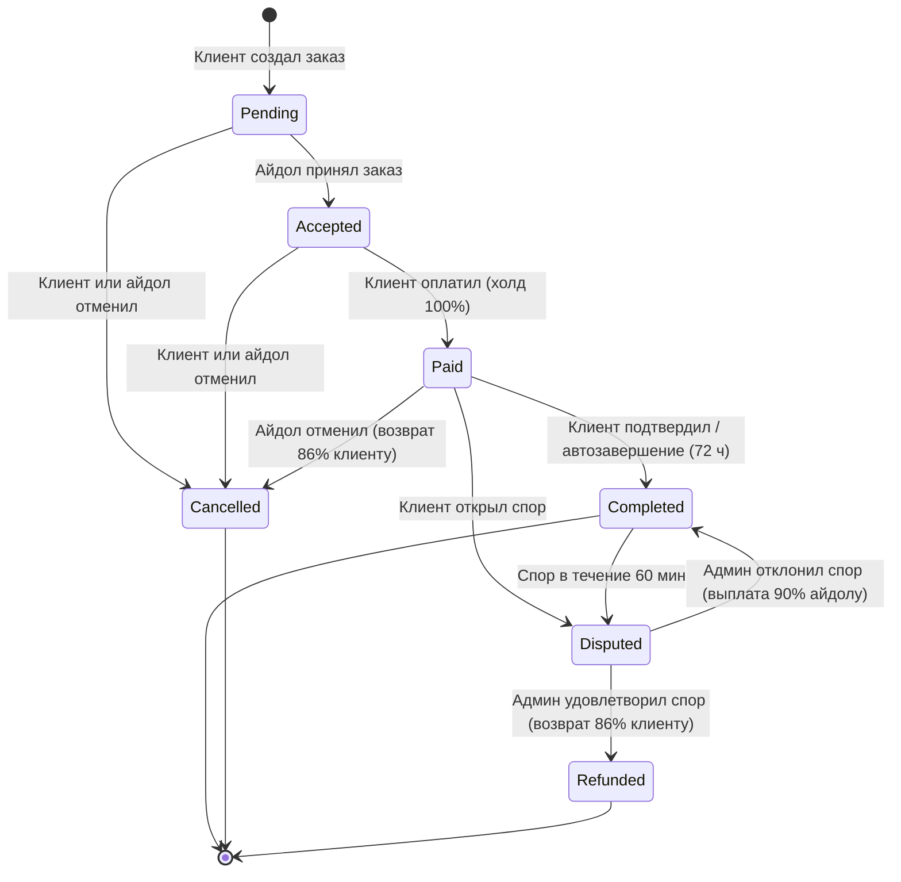

# Not Alone — Правила проекта, Архитектурные инварианты и Стандарты (RULES.md)

> Данный документ является **единым источником правды (Single Source of Truth)** о бизнес-логике, архитектуре, финансовых правилах и стандартах разработки платформы Not Alone. Любой AI-агент или разработчик обязан руководствоваться этими правилами перед внесением изменений.

---

## 1. Главные правила разработки и инфраструктура

### 1.1. Запуск тестов и команд (КРИТИЧЕСКИЙ СТАНДАРТ)
* **ЗАПРЕЩЕНО** запускать `php`, `artisan` или `phpunit` напрямую на хост-машине (на хосте отсутствует окружение и зависимости).
* **ВСЕ команды и тесты запускаются ИСКЛЮЧИТЕЛЬНО внутри Docker-контейнера:**
  ```bash
  # Запуск всех тестов:
  docker exec not_alone_app php artisan test

  # Запуск конкретного теста:
  docker exec not_alone_app php artisan test tests/Feature/RefundCommissionDeductionTest.php

  # Миграции и сидеры:
  docker exec not_alone_app php artisan migrate
  docker exec not_alone_app php artisan db:seed

  # Форматирование кода (Pint):
  docker exec not_alone_app ./vendor/bin/pint

  # Сборка фронтенда:
  npm run build
  ```

### 1.2. Технологический стек
* **Бэкенд:** PHP 8.4.x, Laravel 11 (`v11.48+`).
* **База данных:** PostgreSQL 16 Alpine (порт хоста `5433`, внутри `5432`).
* **Кэш, Сессии, Очереди:** Redis Alpine (`SESSION_DRIVER=redis`, `QUEUE_CONNECTION=redis`, `CACHE_STORE=redis`).
* **Фронтенд:** Vue 3 (Composition API), Inertia.js v2 (`@inertiajs/vue3`), Vite 6, Tailwind CSS 3, Element Plus.
* **WebSockets / Realtime:** Laravel Reverb (порт `8080`).
* **S3 / Хранилище медиа:** MinIO (S3 API `9000`, консоль `8900`, bucket `not-alone`).
* **Dev Mail:** Mailpit (веб-интерфейс `8025`, SMTP `1025`).

---

## 2. Роли пользователей и матрица прав

| Роль | Модель / Guard | Права и ключевые особенности | Ограничения |
|---|---|---|---|
| **Клиент** | `User`<br>`is_idol = false` | Поиск айдолов, 1 бесплатный пробный заказ (Trial, 0 ₽) на айдола, пополнение баланса, оплата заказов, диспуты, отзывы, покупка паков, рамки достижений. | ❌ **Вывод средств запрещён** (деньги остаются в кошельке платформы).<br>❌ **Прямая отмена оплаченного заказа запрещена** (только через диспут).<br>❌ Не может создавать платные услуги и паки. |
| **Айдол** | `User`<br>`is_idol = true` | Все права клиента + получение рейтинга (0–100), создание услуг и паков, подтверждение выполнения заказов, вывод средств на карту. | ❌ Цены услуг ограничены `ServicePriceLimit` (для рейтинга < 30 действует пониженный лимит).<br>❌ Запрещено покупать свои паки и заказывать у себя.<br>❌ Овердрафт баланса ограничен `-50 000.00 ₽`. |
| **Администратор** | `Admin`<br>guard: `admin` | Модерация заявок айдолов, услуг и паков, разрешение споров/диспутов, страйки (3 страйка = бан), финансовые корректировки, аудит логов, управление `PlatformSetting`. | ❌ Не участвует в сделках как клиент/айдол. |

---

## 3. Финансовая система, кошельки и эскроу (WalletService)

### 3.1. Closed-loop модель кошельков
* Все расчёты ведутся во внутренней валюте (RUB) через таблицу `wallets`. Прямой P2P-перевод между пользователями запрещён.
* **Пополнение (`deposit`):** удерживается комиссия `deposit_fee_percent = 4.0%` (на баланс клиента зачисляется чистая сумма `net_deposit = amount - 4%`).
* **Вывод (`withdraw`):** доступен **только айдолам** (`is_idol = true`). Удерживается комиссия `withdrawal_fee_percent = 4.0%`.

### 3.2. Эскроу при оплате заказа
1. **Оплата (`hold`):** при оплате заказа сумма перемещается из доступного `balance` клиента в `held_balance` (`OrderHold`).
2. **Завершение (`releaseHold`):**
   - У клиента `held_balance` списывается до 0 (`OrderHoldRelease`).
   - Платформа удерживает базовую комиссию: `platform_fee_percent = 10.0%`.
   - Чистая выплата айдолу: $\text{net\_payout} = \text{held\_amount} - 10\%$.
   - **Окно безопасности:** чистая выплата зачисляется в `held_balance` айдола на **60 минут** (`order_dispute_window_minutes`).
3. **Выплата айдолу (`releaseIdolPayout`):** по истечении 60 минут при отсутствии открытых споров средства переходят в доступный `balance` айдола.

### 3.3. Возвраты средств (Refunds) и НЕВОЗВРАТНЫЕ комиссии
При отмене оплаченного заказа или одобрении спора администратором в пользу клиента:
* **СТРОГИЙ ИНВАРИАНТ:** Комиссии платёжного шлюза и платформы **НЕВОЗВРАТНЫ ВО ВСЕХ СЛУЧАЯХ**:
  - `refund_gateway_fee_percent = 4.0%`
  - `refund_platform_fee_percent = 10.0%`
  - Суммарное удержание: **14.0%**.
* **Формула возврата клиенту:**
  $$\text{gw\_fee} = \text{roundFee}(\text{held\_amount},\, 4.0\%)$$
  $$\text{plat\_fee} = \text{roundFee}(\text{held\_amount},\, 10.0\%)$$
  $$\text{net\_refund} = \max(0.00,\, \text{held\_amount} - (\text{gw\_fee} + \text{plat\_fee}))$$
* **Движение балансов:**
  - `held_balance` клиента уменьшается на $100\%$ суммы заказа.
  - `balance` клиента увеличивается на $\text{net\_refund}$ (86%).
  - Разница остаётся на счетах сервиса. В транзакцию `OrderRefund` пишется полный аудит в `metadata`.
  - Удержанная комиссия платформы учитывается в отчётах админки как доход сервиса.

### 3.4. Овердрафт айдола и защита возврата клиенту
* Если возврат по спору происходит после 60-минутного окна (когда деньги уже на балансе айдола), система списывает выплату с баланса айдола (`OrderClawback`).
* В PostgreSQL действует жесткий констрейнт: `CHECK (balance >= -50000.00)`.
* При балансе $\le -40\,000.00\text{ ₽}$ логируется критический алерт (`CRITICAL_OVERDRAFT_THRESHOLD`).
* **Защита клиента:** Если баланс айдола достигает предела `-50 000.00 ₽`, возврат клиенту **НЕ блокируется** — клиент гарантированно получает свой `net_refund`, а разницу покрывает платформа.

### 3.5. Идемпотентность
* Каждая транзакция кошелька имеет `idempotency_key` с уникальным индексом `UNIQUE`.
* Повторный вызов с тем же ключом валидирует совпадение параметров и мягко возвращает созданную транзакцию без дублирования списаний/начислений.

---

## 4. Жизненный цикл заказов (Order Lifecycle)



### 4.1. Правила отмены и подтверждения
* **Клиент:** может отменить заказ **только до оплаты** (`pending`, `accepted`). После оплаты прямая отмена заблокирована — только открытие спора (`Disputed`).
* **Айдол:** может отменить в статусах `pending`, `accepted` и `paid` (при отмене оплаченного клиенту начисляется возврат за вычетом комиссий).
* **Завершение:** подтверждение со стороны клиента мгновенно завершает заказ. Если подтвердил только айдол — запускается ожидание клиента либо автозавершение через **72 часа** (`order_auto_complete_delay`).
* **Пробные заказы (Trial):** 0 ₽, строго `quantity = 1`, доступен 1 раз для каждого айдола (учёт в `user_idol_trials`).

### 4.2. Лимиты цен на услуги (ServicePriceLimit)
* Лимиты привязаны к категориям `ServiceCategory`.
* Поля: `max_price` (общий потолок) и `low_rating_max_price` (пониженный потолок для рейтинга айдола $< 30$).
* Сохранение цены услуги выше разрешённого лимита блокируется валидацией.

---

## 5. Система рейтинга айдолов (IdolRatingService)

### 5.1. Базовые правила
* Рейтинг формируется **только у айдолов** (`is_idol = true`), диапазон **0.00 – 100.00**, старт при создании: **20.00**.
* Порог «низкого рейтинга»: **30.00** (`rating_low_threshold`). При падении ниже 30 айдол получает предупреждение и ограничение цен на услуги.

### 5.2. Таблица событий и дельт

| Событие | Дельта | Триггер |
|---|:---:|---|
| `review_5star` | **+0.8** | Отзыв клиента 5★ |
| `review_4star` | **+0.4** | Отзыв клиента 4★ |
| `review_3star` | **0.0** | Отзыв клиента 3★ (нейтральный) |
| `review_2star` | **-0.5** | Отзыв клиента 2★ |
| `review_1star` | **-1.2** | Отзыв клиента 1★ |
| `order_completed` | **+0.2** | Заказ успешно выполнен |
| `order_refunded` | **-0.2** | Заказ аннулирован с возвратом |
| `report_accepted` | **-2.0** | Жалоба на айдола подтверждена администратором |
| `review_dispute_approved` | **+0.6** | Спор по отзыву удовлетворён администратором (отзыв скрыт) |
| `strike` | -0.1 .. -1.0 | Страйк от администратора |
| `strike_cancelled` | +0.1 .. +1.0 | Полный возврат списанного за страйк рейтинга при отмене |
| `admin_manual` | Произвольная | Ручная корректировка администратором с комментарием |

### 5.3. Формула асимптотики (Dampening)
Применяется **только к положительным дельтам** (чем выше текущий рейтинг, тем медленнее он растёт):
$$\text{effectiveDelta} = \max\left(0.01,\, \text{round}\left(\text{baseDelta} \times \frac{100 - \text{currentRating}}{80},\, 2\right)\right)$$
*Отрицательные дельты (штрафы) применяются в полном размере без изменений.*

### 5.4. Защита от накрутки
* Уникальный индекс `(customer_id, idol_id)` в `reviews` — максимум один отзыв на пару.
* Отзыв разрешён только к завершённому заказу (`status = completed`).
* Посты в ленте, лайки и комментарии на рейтинг не влияют.
* Все изменения пишутся в журнал `idol_rating_logs`.

---

## 6. Контент-паки (Content Packs)
* Создаются только айдолами. Стоимость: от `100 ₽` до `10 000 ₽`.
* Новые паки проходят пре-модерацию администратором (`moderate_new_packs = 1`).
* Редактирование опубликованных паков происходит через `ContentPackChangeRequest`.
* Покупка: защита от покупки собственных паков и повторной покупки одного и того же пака.
* Комиссия платформы: `platform_fee_percent = 10.0%`. Автор получает 90% сразу на доступный баланс.

---

## 7. Аватарки и рамки достижений (AvatarFrames)
* **Типы рамок:** `free` (бесплатные), `paid` (покупка за рубли), `achievement` (автоматическая разблокировка за достижения).
* **Условия достижений (`ConditionRegistry`):** выполненные заказы (10, 25, 50, 100), заработок (10k, 100k ₽), высокий рейтинг (40, 50), отзывы (50), продажи паков, посты, подписчики.
* **Экипировка:** поле `users.active_frame_id`. Пользователь может надеть/снять любую открытую рамку.

---

## 8. Карта ключевых файлов проекта

* **Финансы и кошельки:**
  - Сервис: `app/Services/WalletService.php`
  - Модели: `app/Models/Wallet.php`, `app/Models/WalletTransaction.php`
  - Перечисления: `app/Enums/WalletTransactionType.php`
  - Контроллер: `app/Http/Controllers/WalletController.php`
* **Заказы и услуги:**
  - Сервисы: `app/Services/OrderService.php`, `app/Services/IdolRatingService.php`
  - Модели: `app/Models/Order.php`, `app/Models/OrderItem.php`, `app/Models/Service.php`, `app/Models/ServiceCategory.php`, `app/Models/ServicePriceLimit.php`
  - Перечисления: `app/Enums/OrderStatus.php`
  - Контроллеры: `app/Http/Controllers/OrderController.php`, `app/Http/Controllers/ServiceController.php`
* **Админка и настройки:**
  - Контроллеры: `app/Http/Controllers/Admin/PlatformSettingsController.php`, `app/Http/Controllers/Admin/TransactionController.php`, `app/Http/Controllers/Admin/DisputeController.php`, `app/Http/Controllers/Admin/OrderController.php`
  - Модель настроек: `app/Models/PlatformSetting.php`
  - Фронтенд настроек: `resources/js/Pages/Admin/Settings.vue`
* **Контент-паки и рамки:**
  - Паки: `app/Models/ContentPack.php`, `app/Http/Controllers/ContentPackPurchaseController.php`
  - Рамки: `app/Models/AvatarFrame.php`, `app/Services/AvatarFrames/ConditionRegistry.php`

---

## 9. Сводная таблица параметров системы (`PlatformSetting`)

| Ключ | Дефолт | Описание |
|---|:---:|---|
| `deposit_fee_percent` | `4.0%` | Комиссия на пополнение кошелька |
| `withdrawal_fee_percent` | `4.0%` | Комиссия на вывод средств (только айдолы) |
| `platform_fee_percent` | `10.0%` | Базовая комиссия платформы со сделок и паков |
| `refund_gateway_fee_percent` | `4.0%` | Невозвратная комиссия платёжной системы при возврате |
| `refund_platform_fee_percent`| `10.0%` | Невозвратная комиссия платформы при возврате |
| `order_dispute_window_minutes` | `60` мин | Окно холда выплаты айдолу и подачи спора клиентом |
| `order_auto_complete_delay` | `72.0` ч | Время автозавершения заказа после подтверждения айдолом |
| `rating_low_threshold` | `30` | Порог низкого рейтинга айдола |
| `content_pack_price_min` | `100` ₽ | Минимальная цена контент-пака |
| `content_pack_price_max` | `10 000` ₽ | Максимальная цена контент-пака |
| `moderate_new_packs` | `1` | Пре-модерация новых контент-паков |
| `rating_delta_review_5star` | `+0.8` | Дельта рейтинга за отзыв 5★ |
| `rating_delta_review_4star` | `+0.4` | Дельта рейтинга за отзыв 4★ |
| `rating_delta_review_2star` | `-0.5` | Дельта рейтинга за отзыв 2★ |
| `rating_delta_review_1star` | `-1.2` | Дельта рейтинга за отзыв 1★ |
| `rating_delta_order_completed`| `+0.2` | Дельта рейтинга за успешный заказ |
| `rating_delta_report_accepted`| `-2.0` | Штраф рейтинга за подтверждённую жалобу |
| `rating_delta_review_dispute_approved` | `+0.6` | Компенсация рейтинга при удовлетворении спора по отзыву |
