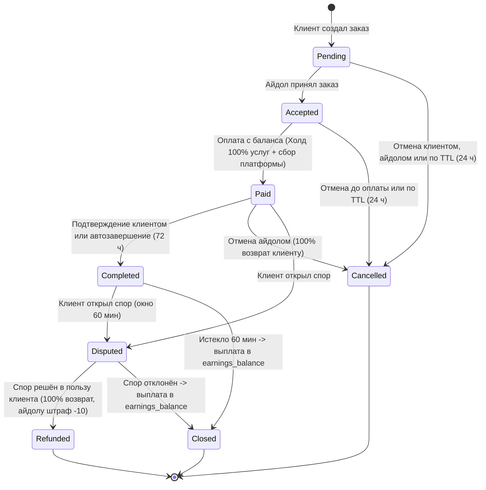

# ТЗ: Платёжная и расчётная система Not Alone на базе Mandarin BaaS (РФ)

> **Статус документа:** Итоговое утверждённое Техническое Задание (v1.5, эталонная редакция: регуляторный щит 103-ФЗ, 152-ФЗ, API контракты и DDL миграций).
> **Юрисдикция:** Российская Федерация (РФ).
> **Платёжный провайдер:** Финтех-платформа **Mandarin (mandarin.io)** — сервис **BaaS (Banking-as-a-Service)** на базе **Номинального счёта (ст. 860.1 ГК РФ)**.
> **Налоговый режим исполнителей:** Самозанятые граждане РФ (плательщики НПД по 422-ФЗ) с автоматической фискализацией в ФНС («Мой налог»).

---

## 1. Юридическая и налоговая модель (РФ)

### 1.1. Статус платформы, номинальный счёт (ст. 860.1 ГК РФ) и статус бенефициаров

1. **Проблема классического эквайринга на расчётный счёт:** Если платформа принимает деньги клиентов на свой обычный расчётный счёт (40702) и затем переводит их физическим лицам, налоговая служба (ФНС) признаёт весь оборот (100% входящих денег) доходом платформы (что смертельно для УСН «Доходы» 6% или «Доходы минус расходы»), а банки блокируют счета по 115-ФЗ (подозрение на транзит и обналичивание) и 161-ФЗ / 103-ФЗ (незаконная банковская / платёжно-агентская деятельность без лицензии ЦБ РФ).
2. **Решение через Mandarin BaaS:** Платформа открывает **Номинальный счёт (ст. 860.1–860.6 ГК РФ)** в банке-партнёре через инфраструктуру Mandarin.
   - **Владелец счёта:** Юридическое лицо платформы (Оператор/Агент).
   - **Бенефициары счёта (требование 115-ФЗ):** Во исполнение п. 1.4-1 ст. 7 Федерального закона № 115-ФЗ бенефициарами номинального счёта выступают **исключительно Айдолы (исполнители услуг)**, прошедшие процедуру идентификации при онбординге. Средства клиентов учитываются на счёте как депонированный аванс в пользу бенефициаров, принимаемый агентом до момента совершения сделки. В договоре с банком прямо фиксируется, что проценты на остаток по номинальному счёту не начисляются (ст. 860.4 ГК РФ). При аресте средств конкретного бенефициара со стороны ФССП (п. 2 ст. 860.5 ГК РФ) банк замораживает выплаты только данному исполнителю без ущерба для остальных участников.
   - **Изоляция средств:** Деньги на номинальном счёте юридически **не принадлежат платформе**. На них не может быть обращено взыскание по долгам платформы (п. 1 ст. 860.5 ГК РФ), они не входят в конкурсную массу при банкротстве оператора (ст. 133.1 ФЗ № 127-ФЗ «О несостоятельности (банкротстве)») и защищены от блокировок по 115-ФЗ со стороны собственных обязательств оператора.
   - **Налоговая база платформы:** Платформа работает по **Агентскому договору (ст. 1005 ГК РФ)**. Доходом платформы является **исключительно её агентское вознаграждение** (`platform_reward = customer_service_fee + platform_fee`). Только с этой суммы исчисляется налог (УСН/ОСНО). Денежная масса, проходящая транзитом через номинальный счёт в пользу исполнителей, доходом площадки не является.
3. **Неприменение Федерального закона № 103-ФЗ («О платёжных агентах»):**
   - Деятельность платформы **не является деятельностью платёжного агента** и не подлежит надзору/лицензированию ЦБ РФ (включая поправки 298-ФЗ от 01.10.2024), не требует включения в реестр ОПП, вступления в СРО и открытия спецсчетов 40821 по следующим законным основаниям:
     - **Императивное исключение (п. 1 ч. 2 ст. 1 103-ФЗ):** Закон № 103-ФЗ прямо не применяется к отношениям, связанным с осуществлением расчётов **в безналичном порядке** (платформа принимает оплату исключительно безналично через эквайринг и СБП).
     - **Расчёты через кредитные организации (п. 4 ч. 2 ст. 1 103-ФЗ):** Приём и перечисление средств осуществляются банком-партнёром Mandarin по лицензии Банка России через номинальный счёт (ст. 860.1 ГК РФ).
     - **Агентская модель (ст. 1005 ГК РФ):** Платформа действует от имени принципала в рамках договора оказания услуг/предоставления контента, организуя сделки, а не как платёжный агрегатор в чужих расчётах.

### 1.2. Обязательный «Отчёт Агента» (ст. 1008 ГК РФ, ст. 9 402-ФЗ, 63-ФЗ) и бухгалтерский учёт

1. **Юридическая сила и первичный учётный документ (ст. 9 402-ФЗ, ст. 6 63-ФЗ):**
   - В соответствии со ст. 1008 ГК РФ и правоприменительной практикой ФНС (Определение ВС РФ № 307-ЭС19-27597, Письма Минфина РФ № 03-11-06/2/9448, № 03-11-11/84754), надлежащим подтверждением агентского статуса сделок и права не включать весь оборот в налогооблагаемую базу является **регулярное составление и предоставление Принципалу (Айдолу) Отчёта Агента**.
   - Во исполнение требований ч. 2 ст. 9 Федерального закона № 402-ФЗ «О бухгалтерском учёте» Отчёт Агента содержит все обязательные реквизиты первичного учётного документа: наименование («Отчёт Агента об исполнении поручения»), дату составления, реквизиты сторон (ООО Оператора и 12-значный ИНН/ФИО айдола), содержание фактов хозяйственной жизни (детальный реестр ID сделок, даты, суммы услуг, удержанные вознаграждения, ссылки на чеки «Мой налог»), величину в рублях РФ.
   - **Соглашение об электронной подписи (ст. 6 63-ФЗ):** В Оферту вносится положение: *«Стороны признают электронные Отчёты Агента, сформированные в информационной системе Платформы, равнозначными документам на бумажном носителе, подписанным собственноручной подписью. Простой электронной подписью (ПЭП) Принципала признаётся авторизация в Личном кабинете с использованием подтверждённого телефонного номера и одноразовых паролей (OTP) с фиксацией IP-адреса и цифрового отпечатка документа»*.
2. **Срок приёма возражений (ст. 1008 п. 3 ГК РФ):**
   - Ежемесячно (1-го числа каждого месяца) и по запросу в личном кабинете айдола формируется электронный «Отчёт Агента об исполнении поручения».
   - В Оферте закрепляется срок возражений: *«Если в течение 10 (десяти) рабочих дней с момента размещения электронного Отчёта Агента в личном кабинете от Принципала не поступило мотивированных письменных возражений, Отчёт считается утверждённым без замечаний, а услуги Агента — оказанными надлежащим образом и в полном объёме»*. Увеличенный до 10 рабочих дней срок полностью нивелирует риски признания условия несправедливым по ст. 428 ГК РФ (договор присоединения).
3. **План счетов и бухгалтерские проводки платформы (Приказ Минфина РФ № 94н, ФСБУ):**
   - Средства на номинальном счёте учитываются на счёте **55.04 «Номинальный счёт для расчётов с принципалами»**.
   - При пополнении клиентом: `Дт 55.04 — Кт 76.Клиенты` (1 000.00 ₽, авансовый чек 54-ФЗ).
   - При оплате заказа: `Дт 76.Клиенты — Кт 76.Эскроу` (стоимость услуги) и `Дт 76.Клиенты — Кт 62.Клиенты` (сервисный сбор 5%), `Дт 62.Клиенты — Кт 90.01` (признание выручки платформы 5%, чек 54-ФЗ).
   - При закрытии сделки: `Дт 76.Эскроу — Кт 76.Айдолы` (услуга оказана), `Дт 76.Айдолы — Кт 62.Айдолы` и `Дт 62.Айдолы — Кт 90.01` (признание комиссии 12%), `Дт 76.Айдолы — Кт 62.Айдолы` (зачёт комиссии по ст. 410 ГК РФ).
   - При выплате айдолу по СБП: `Дт 76.Айдолы — Кт 55.04` (чистая выплата принципалу с номинального счёта).
   - При переводе агентского дохода платформы (Revenue Sweep): `Дт 51 (р/с 40702) — Кт 55.04` (перевод собственного агентского вознаграждения).
   - **Итог:** Выручка по счёту 90.01 платформы формируется строго в размере агентского вознаграждения (170 ₽ с 1 000 ₽ базового заказа).

### 1.3. Статус исполнителей (Айдолов): Самозанятые (422-ФЗ) и защита от аннулирования чеков

1. Все исполнители (айдолы), получающие выплаты, обязаны иметь статус плательщика **Налога на профессиональный доход (НПД)** с подтверждённым 12-значным ИНН гражданина РФ.
2. Платформа подключает официальный API-модуль Mandarin для работы с самозанятыми (`/self-employed-2/v1`):
   - **Связка с ФНС:** Айдол привязывает свой ИНН на платформе и подтверждает партнёрство в официальном мобильном приложении **«Мой налог»** (раздел «Партнёры» -> Mandarin / Not Alone).
   - **Контроль лимитов:** Перед каждой выплатой система через Mandarin автоматически запрашивает статус в ФНС и проверяет, не аннулирован ли статус НПД и не превышен ли годовой лимит выручки (**2,4 млн рублей**).
   - **Автофискализация чеков:** При переходе заказа/покупки в статус `Closed` Mandarin автоматически регистрирует чек от имени самозанятого в ФНС («Мой налог») с наименованием услуги и передаёт ссылку на чек платформе и айдолу. При последующей еженедельной выплате в понедельник ссылка на ранее зарегистрированный чек прикрепляется к платёжному реестру. Это полностью исключает риск переквалификации отношений в трудовые и доначисления 13% НДФЛ и 30% страховых взносов.
3. **Защита от недобросовестного аннулирования чеков айдолами:**
   - Риск: айдол получает выплату, после чего вручную аннулирует чек в приложении «Мой налог» для неуплаты налога 4–6%. В этом случае ФНС признаёт выплату доходом физлица и доначисляет платформе 13% НДФЛ и 30% взносов (Письмо ФНС РФ от 28.10.2021 № ПА-4-20/15213@).
   - Защита:
     - Крон-команда `self-employed:monitor-receipts` еженедельно проверяет статус ранее выданных чеков через API Mandarin.
     - В Оферту вносится пункт: *«В случае аннулирования чека в приложении „Мой налог“ без уважительной причины Принципал обязуется возместить Агенту возникшие убытки в полном объёме (включая суммы доначисленных налогов, страховых взносов и штрафов), а также уплатить штраф в размере 100% от суммы аннулированного чека. Агент имеет право на безакцептное удержание указанных сумм из любого последующего заработка Принципала»*.

### 1.4. Применение контрольно-кассовой техники (54-ФЗ) и разделение чеков

1. **Кассовый баланс и соблюдение 54-ФЗ / 422-ФЗ:**
   - В момент покупки клиентом пакета монет `CoinPack` через интернет-эквайринг Mandarin платформа в автоматическом режиме формирует кассовый чек онлайн-кассы по 54-ФЗ с признаком способа расчёта **«Аванс»** (или «Предоплата 100%») на полную сумму внесённых рублей.
   - В момент оплаты заказа покупатель вносит `total_customer_charge` (например, 2 100 ₽ = 2 000 ₽ стоимость услуги + 100 ₽ сервисный сбор платформы).
   - **Чек №1 (Онлайн-касса платформы по 54-ФЗ):** Выбивается платформой клиенту в момент успешной оплаты **строго на сумму сервисного сбора платформы** (`customer_service_fee` = 100.00 ₽, признак способа расчёта: «Полный расчёт» с зачётом аванса, предмет: услуга). При отмене заказа по вине айдола или подтверждении диспута арбитражем платформы клиенту возвращается сбор с формированием кассового чека «Возврат прихода» по 54-ФЗ.
   - **Чек №2 (Чек самозанятого по 422-ФЗ в «Мой налог»):** Формируется через API Mandarin от имени айдола клиенту **на полную стоимость оказанной услуги** (`service_amount` = 2 000.00 ₽, в соответствии с Письмом ФНС России от 11.11.2019 № СД-4-3/22883@). Регистрация чека производится **автоматически при переходе заказа в статус `Closed`** (сделка принята заказчиком), с обязательным указанием признака B2C-расчёта (ставка налога 4%). При последующей еженедельной выплате в понедельник ссылка на ранее зарегистрированный чек прикрепляется к платёжному реестру.
   - Итого покупатель получает электронные фискальные чеки ровно на всю сумму платежа (аванс по 54-ФЗ -> зачёт сбора 100 ₽ по 54-ФЗ + чек исполнителя 2 000 ₽ по 422-ФЗ). Это исключает любые налоговые и кассовые претензии со стороны ФНС и Роспотребнадзора.
   - Комиссия платформы с айдола (`platform_fee` = 240.00 ₽ при ставке 12%) удерживается платформой на основании Отчёта Агента и ст. 410 ГК РФ (зачёт встречных требований) и не требует отдельного кассового чека клиенту.

### 1.5. Возврат неиспользованного баланса клиентам (ст. 32 ЗОЗПП, 115-ФЗ)

1. **Запрет произвольного вывода (Cash-out):** Свободный вывод средств с клиентского потребительского счёта на произвольные карты/счета строго запрещён во избежание нарушений 115-ФЗ (борьба с отмыванием денег и обналичиванием).
2. **Легальный возврат аванса (Refund):** Согласно ст. 32 Закона РФ «О защите прав потребителей» и ст. 782 ГК РФ, потребитель имеет право в любой момент отказаться от исполнения договора и потребовать возврата неиспользованного аванса.
3. **Механизм возврата:** Возврат осуществляется **исключительно на ту же банковскую карту или счёт СБП, с которого было совершено пополнение**, в регламентный срок до 10 календарных дней (ст. 31 ЗОЗПП). В интерфейсе возврат оформляется через заявку в службу поддержки, а администратор инициирует возврат через операцию `refund` платёжного шлюза Mandarin. При невозможности реверса (карта заблокирована банком, счёт закрыт) возврат возможен на иной банковский счёт потребителя при документальном подтверждении совпадения ФИО и закрытия счёта карты.

### 1.6. Персональные данные (152-ФЗ), локализация серверов в РФ и архивное хранение

1. **Поручение обработки ПДн (ч. 3 ст. 6 152-ФЗ):**
   - Передача данных айдола (ФИО, ИНН, телефон СБП, банк) в адрес ООО «Мандарин» и банка-партнёра осуществляется на основании прямого согласия субъекта ПДн и обусловлена исполнением агентского соглашения и требованиями ПОД/ФТ (п. 1.4-1 ст. 7 115-ФЗ).
   - Согласие подписывается Простой Электронной Подписью (ПЭП) по 63-ФЗ в момент привязки ИНН/реквизитов.
2. **Локализация баз данных в РФ (ч. 5 ст. 18 152-ФЗ, 242-ФЗ):**
   - Все базы данных (PostgreSQL 16, Redis) и хранилища медиа/документов (MinIO) размещены физически в аттестованных дата-центрах на территории Российской Федерации.
   - Трансграничная передача данных отсутствует.
3. **Срок архивного хранения финансовых документов (ст. 29 402-ФЗ, 115-ФЗ):**
   - При добровольном закрытии профиля айдола его учётная запись деактивируется (Soft Delete).
   - Первичные учётные документы (Отчёты Агента), фискальные чеки, реестры СБП и данные идентификации хранятся в зашифрованном архиве не менее **5 (пяти) лет** в соответствии с требованиями бухгалтерского учёта и законодательства ПОД/ФТ.

---

## 2. Архитектура счетов, визуальные монеты и пакеты пополнения (CoinPack)

### 2.1. Визуальные монеты в интерфейсе (UI) и юридический статус (ст. 317 п. 2 ГК РФ, ст. 10 ЗОЗПП)

1. **Визуальное отображение (UI):**
   - Во всём пользовательском интерфейсе (каталог услуг, карточки айдолов, балансы, стоимость контент-паков, донаты) суммы отображаются в виде **монет** (`1 000 🪙`, синие монеты для клиентов и розовые монеты для заработка айдолов).
   - Во избежание претензий Роспотребнадзора по ст. 10 Закона РФ «О защите прав потребителей» (предоставление информации о цене в рублях РФ), в интерфейсе рядом с монетами или при наведении/в подсказках указывается рублёвый эквивалент: `1 000 🪙 (1 000 ₽)`.
2. **Юридический статус в Оферте:**
   - В соответствии с п. 2 ст. 317 ГК РФ, монета платформы Not Alone является **внутренней расчётной/учётной единицей**, эквивалентной российскому рублю:
     $$\mathbf{1\text{ монета}} = \mathbf{1.00\text{ рубль РФ (RUB)}}$$
   - На этапе пополнения баланса (чекаут) потребителю обязательно раскрывается сумма в рублях: *«Пополнение: 1 000 монет за 1 000 ₽»*.
   - Электронный чек онлайн-кассы по 54-ФЗ пробивается строго в российских рублях.
3. **Хранение в БД:**
   - В базе данных все поля сумм имеют тип `numeric(12,2)`. Все расчёты выполняются строго через `bcmath` с округлением half-up до 2 знаков.

### 2.2. Пакетная система пополнения баланса (CoinPack)

1. **Законность пакетной продажи (ст. 421 ГК РФ):**
   - Пополнение баланса клиентами осуществляется **исключительно фиксированными пакетами монет** (модель `CoinPack`). Произвольный ввод произвольных копеечных сумм отсутствует.
   - Это на 100% законно по ст. 421 ГК РФ (свобода договора) и аналогично моделям VK (Голоса), Twitch (Bits), игровым сервисам и мобильным приложениям.
   - **Фискализация пополнения:** В момент успешной оплаты пакета монет через эквайринг Mandarin платформа в автоматическом режиме формирует кассовый чек по 54-ФЗ с признаком способа расчёта «Аванс» (или «Предоплата 100%») на полную сумму внесённых рублей.
2. **Базовая сетка пакетов пополнения:**
   - **Разовый стартер-пак (`is_starter = true`):** `300.00 ₽` (300 🪙) — доступен к покупке строго **1 раз на аккаунт** (учёт в `coin_pack_purchases`). Идеален для первой пробы платформы.
   - **Регулярные пакеты (`is_starter = false`):** `500.00 ₽` (500 🪙), `700.00 ₽` (700 🪙), `1 000.00 ₽` (1 000 🪙). Доступны всегда без ограничений по количеству покупок.
   - Сетка пакетов полностью администрируется через админ-панель (видимость `is_visible`, порядок `sort_order`).
3. **Логика чекаута при нехватке монет:**
   - Никакой произвольной микродоплаты.
   - Если клиенту не хватает монет на оплату заказа (например, не хватает 300 🪙):
     - Система автоматически предлагает докупить подходящий пакет из доступных: если стартер-пак на 300 🪙 ещё не куплен — предлагает его; если уже куплен — предлагает минимальный подходящий регулярный пакет (например, 500 🪙).
     - Сдача после покупки пакета остаётся на балансе клиента для будущих заказов или донатов.
4. **Антифрод и лимиты интенсивности операций (AML / Velocity Limits):**
   - **Лимиты на покупку монет:** Не более **15 000.00 ₽ в сутки** и не более **5 транзакций в час** с одного платёжного средства / аккаунта (в пределах порога упрощённой идентификации по 115-ФЗ).
   - **Антифрод-холд первой выплаты (First Payout Freeze):** Для новых айдолов первая выплата по СБП проходит обязательный защитный холд **72 часа** с момента успешной привязки ИНН/СБП для первичного скоринга рисков.
   - **Анти-сговор (Cross-Device/IP Matching):** При совпадении IP-адреса, подсети или Device Fingerprint между покупателем монет и айдолом (подозрение на обналичивание кредитных карт или фиктивные сделки) автовыплата мгновенно блокируется и направляется на ручную проверку комплаенс-офицером.

```mermaid
                           [ Номинальный счёт платформы в банке (RUB) ]
                                         │
                 ┌───────────────────────┴───────────────────────┐
                 ▼                                               ▼
     [ Потребительский счёт ]                        [ Заработанный счёт ]
        (Баланс клиента)                               (Баланс айдола)
         balance: 0.00 🪙                                earnings_balance: 0.00 🪙
       held_balance: 0.00 🪙                          held_earnings_balance: 0.00 🪙
                 │                                               │
                 │ ─── Оплата заказа (Холд 100% услуг) ────────> │
                 │ ─── Сервисный сбор 5% ──────> Доход платформы │
                 │                                               │
                 │ <── 100% возврат услуг при споре/отмене ───── │
                 │                                               │
                 │                         После 60 мин окна спора:
                 │                         Переход в earnings_balance
                 │                                               │
                 │                                               ▼
                 │                                   [ Выплата по СБП (₽) ]
                 │                                   Еженедельный реестр от 1000 ₽
                 │                                   + Ссылка на чек из ФНС
```

### 2.3. Запрет вывода клиентами (Cash-out), порядок возврата аванса (Refund) и внутренняя конвертация

1. **Полное отсутствие кнопки вывода в интерфейсе клиента:**
   - В интерфейсе клиента кнопка «Вывести средства» **полностью отсутствует**.
   - Клиентский баланс предназначен **исключительно для оплаты услуг, контент-паков и отправки донатов** на платформе.
   - Свободный вывод средств на сторонние карты/кошельки физлицам без статуса самозанятого категорически запрещён во исполнение требований **115-ФЗ (ПОД/ФТ)** и **161-ФЗ (НПС)**.
2. **Юридический порядок возврата неиспользованного аванса (ст. 32 ЗОЗПП):**
   - Если клиент решает прекратить использование сервиса и требует вернуть неиспользованный остаток, возврат осуществляется исключительно в заявительном порядке через обращение в службу поддержки.
   - Администратор производит операцию **Refund** через платёжный шлюз Mandarin **строго на ту же самую банковскую карту / счёт**, с которой клиент совершал пополнение баланса.
   - 99.8% клиентов используют баланс для покупок внутри сервиса, а наличие регламента возврата в Оферте полностью защищает платформу от претензий Роспотребнадзора и судебных рисков.
3. **Конвертация заработка в потребительский баланс (`convertPinkToBlue`):**
   - Айдол имеет право в любой момент конвертировать любую часть доступных заработанных средств (`earnings_balance` / `pink_balance`) в потребительский баланс (`balance`) по курсу **1:1** для покупок услуг других айдолов, контент-паков или отправки донатов без комиссии.
   - Поскольку доход айдола уже был официально учтён и фискализирован в ФНС («Мой налог») в момент закрытия сделки, конвертация представляет собой распоряжение собственными чистыми средствами.
   - **Обратная конвертация (`balance` -> `earnings_balance`) категорически заблокирована**, что исключает любые серые схемы ввода-вывода (обналичивания).

---

## 3. Тарифы, сборы и финансовые формулы

### 3.1. Единая комиссионная модель («Всё включено», Вариант А)

1. **Принцип All-inclusive (0% на вывод):**
   - Платформа удерживает единую агентскую комиссию со стоимости выполненной услуги/пака/доната: `platform_fee_percent = 12.00%`.
   - **Вывод для айдола — строго 0.00 ₽ (0%):** Все банковские расходы шлюза Mandarin на проведение исходящих выплат (по СБП и банковским картам) полностью покрываются платформой из её агентского вознаграждения. Никаких дополнительных скрытых комиссий или вычетов при выплате нет. Сколько айдол заработал — ровно столько поступает на его банковскую карту.
   - **Покрытие входящего эквайринга:** Комиссия интернет-эквайринга Mandarin за приём платежей при покупке `CoinPack` также полностью покрывается платформой из совокупного агентского дохода (17%). Клиент получает на баланс ровно 1.00 монету за каждый внесённый рубль без удержаний.
2. **Параметры заказов (Snapshot-принцип):**
   - `order_customer_service_fee_percent` = **5.00%** (настраивается в админке, дефолт 5.00%). Сервисный сбор платформы, списываемый с покупателя при оформлении заказа. Сбор не возвращается при добровольном отказе клиента от надлежаще исполненного заказа, но компенсируется покупателю в размере 100% (с чеком «Возврат прихода» по 54-ФЗ) при отмене заказа по вине айдола или подтверждении спора арбитражем платформы.
   - `platform_fee_percent` = **12.00%** (настраивается в админке, дефолт 12.00%). Агентская комиссия платформы, удерживаемая из стоимости услуги айдола.
   - `order_dispute_window_minutes` = **60** минут (окно подачи жалобы клиентом).
   - `payout_min_threshold` = **1 000.00 ₽** (минимальная сумма для регулярной понедельничной автовыплаты).
   - Комиссия на вывод: **0.00 ₽** (вывод без комиссии).

### 3.2. Расчёт при создании и оплате заказа

1. `service_amount` — цена услуги, установленная айдолом (например, 2 000.00 ₽ / 2 000 🪙).
2. `customer_service_fee` = `money_round(service_amount × customer_service_fee_percent / 100)` (100.00 ₽ при 5%).
3. `platform_fee` = `money_round(service_amount × platform_fee_percent / 100)` (240.00 ₽ при 12%).
4. `total_customer_charge` = `service_amount + customer_service_fee` (2 100.00 ₽ / 2 100 🪙).
5. `net_idol_payout` = `service_amount − platform_fee` (1 760.00 ₽ / 1 760 🪙).
6. `platform_reward` = `customer_service_fee + platform_fee` (340.00 ₽).
7. **Пробные заказы (Trial, 0 🪙 / 0.00 ₽):**
   - Доступен клиенту строго **1 раз для каждого конкретного айдола** (учёт в `user_idol_trials`, строго `quantity = 1`).
   - Стоимость услуги: `0.00 ₽`, сервисный сбор клиента: `0.00 ₽`.
   - Денежное списание и холдирование средств не производятся. Кассовые чеки по 54-ФЗ и чеки в «Мой налог» по 422-ФЗ не формируются (отсутствует денежный расчёт по ст. 1.1 54-ФЗ и доход по ст. 8 422-ФЗ).
   - При отмене или возврате trial-заказа право на бесплатный пробный заказ у данного айдола автоматически восстанавливается.

### 3.3. Холдирование и эскроу

- В момент оплаты заказа с баланса клиента списывается `customer_service_fee` (доход платформы, чек 54-ФЗ), а `service_amount` (100% стоимости услуги) переводится в `held_balance`.
- В момент подтверждения выполнения услуги клиентом:
  - `held_balance` клиента обнуляется.
  - Сумма `net_idol_payout` зачисляется в `held_earnings_balance` айдола.
  - Запускается таймер 60 минут (`payout_available_at = completed_at + 60 minutes`).

### 3.4. Возвраты средств (Refunds) и правило закрытой сделки (No Overdraft)

1. **Строгое окно диспута (Escrow-период):**
   - Пока заказ находится в статусе `Paid`: клиент может открыть спор в любой момент.
   - После подтверждения выполнения услуги клиентом (или автозавершения через 72 ч) заказ переходит в `Completed`, а средства поступают в **холд заработка** (`held_earnings_balance`) ровно на **60 минут**.
   - В течение этих 60 минут клиент имеет техническую возможность открыть диспут (кнопка «Открыть спор»).
   - **Заморозка таймера при споре:** При нажатии кнопки «Открыть спор» статус атомарно меняется на `Disputed`, таймер 60 минут останавливается, а средства остаются замороженными в эскроу-холде до решения арбитража:
     - Если спор **удовлетворён в пользу клиента**: статус переходит в `Refunded`, клиенту возвращается 100% стоимости услуг из холда + 100% сервисного сбора (с чеком 54-ФЗ «Возврат прихода»), холд айдола аннулируется, айдолу начисляется штраф -10 рейтинга.
     - Если спор **отклонён**: статус немедленно меняется на `Closed`, средства выпускаются в `earnings_balance` айдола без дополнительного ожидания таймера.
   - **Окончательное закрытие сделки:** По истечении 60 минут при отсутствии спора заказ автоматически переходит в финальный статус `Closed`, средства выпускаются в доступный `earnings_balance` айдола. **Кнопка открытия спора навсегда блокируется/исчезает. Внутренний арбитраж платформы по закрытому заказу не осуществляется, и возврат средств через платформу становится невозможен.**

2. **Юридическая чистота правила закрытия сделки (ст. 720 ГК РФ):**
   - В соответствии со ст. 720 ГК РФ и свободой договора (ст. 421 ГК РФ), факт приёмки услуги (нажатие кнопки «Подтвердить» или истечение 72 ч) плюс 60 минут защитного окна эскроу являются юридически обязывающим регламентом приёмки.
   - В Оферте фиксируется: *«По истечении 60 минут с момента приёмки Услуги считаются принятыми Заказчиком в полном объёме и без замечаний по качеству. Агентские обязательства Платформы считаются исполненными, сделка — закрытой, а денежные средства — причитающимися Исполнителю. После закрытия сделки финансовые претензии через Платформу не принимаются»*.

3. **Полное отсутствие овердрафтов (Абсолютный инвариант: balance >= 0.00):**
   - Поскольку возврат возможен **исключительно до момента выхода денег из холда**, средства физически и гарантированно присутствуют на номинальном счёте.
   - При удовлетворении спора в пользу клиента:
     - 100% стоимости услуги (`service_amount`) возвращаются клиенту из холда, а 100% сервисного сбора (`customer_service_fee` при вине айдола) компенсируются платформой с формированием чека 54-ФЗ «Возврат прихода».
     - Холд айдола (`held_earnings_balance`) аннулируется до 0.
     - Айдолу начисляется штраф рейтинга: **-10.0** баллов (`rating_delta_order_refunded`).
   - **Вывод:** Баланс айдола `earnings_balance` **НИКОГДА не уходит в минус**. Констрейнт PostgreSQL упрощается до естественного:
     $$\mathbf{earnings\_balance \ge 0.00}$$
   - Исключаются любые риски кассовых разрывов на номинальном счёте, отпадают сложные механизмы регрессных взысканий и овердрафтов. Ситуация становится на 100% безопасной и прозрачной для бухгалтерии.

4. **Балансовое равенство номинального счёта (Financial Invariant):**
   - Совокупный остаток средств клиентов и исполнителей в базе данных Not Alone:
     $$\sum (\text{balance} + \text{held\_balance} + \text{earnings\_balance} + \text{held\_earnings\_balance})$$
     строго равен остатку средств участников на номинальном счёте платформы в банке-партнёре.
   - Ручные административные корректировки балансов без реального пополнения счёта категорически запрещены. Любые маркетинговые бонусы или компенсации покрываются исключительно за счёт собственных средств оператора платформы.

5. **Банковские чарджбэки и регрессное требование к исполнителю (ст. 1081 ГК РФ, 161-ФЗ):**
   - **Окно банковского диспута:** По правилам платёжной системы «МИР» и Закону № 161-ФЗ держатель карты вправе опротестовать платёж в течение 120–180 календарных дней (Friendly Fraud / несанкционированная операция).
   - При поступлении чарджбэка банк-эквайер списывает сумму транзакции с гарантийного депозита платформы.
   - **Регрессное обязательство (ст. 1081 ГК РФ):** В Оферту вносится пункт: *«В случае удовлетворения банком-эмитентом требования об отзыве платежа (чарджбэке) по заказу или контенту Исполнителя, Исполнитель несёт полную материальную ответственность перед Платформой и обязан компенсировать сумму отозванного платежа и штраф платёжной системы. Платформа имеет право на безакцептное удержание суммы регрессного требования из любых последующих поступлений Исполнителя»*.
   - **Учёт без нарушения балансового инварианта:** Долг айдола фиксируется в таблице `chargeback_claims (idol_id, order_id, amount, status, resolved_at)`. Баланс кошелька `earnings_balance` **не уводится в минус** (сохраняя строгий `CHECK (earnings_balance >= 0.00)`), но сумма доступного к выплате заработка уменьшается на величину непогашенных требований (`available_for_payout = max(0.00, earnings_balance - chargeback_debt)`).

---

## 4. Онбординг айдола и налоговая верификация (Mandarin Self-Employed API)

### 4.1. Мягкий онбординг (гейт на выплату)

1. Пользователь может переключить профиль в статус айдола, заполнить анкету, создавать услуги и контент-паки, принимать донаты и накапливать средства на заработанном балансе.
2. Кнопка «Вывести средства» и включение в реестр автовыплат заблокированы до прохождения верификации:
   - Проверка 12-значного ИНН физлица РФ (алгоритм контрольных цифр 11 и 12 разрядов).
   - Подтверждение статуса самозанятого через Mandarin API (`POST /self-employed-2/v1/tin/bind`).
   - Принятие айдолом запроса на партнёрство в приложении «Мой налог».
   - Привязка платёжных реквизитов СБП (номер телефона в формате `79XXXXXXXXX` и выбор банка из справочника `sbp_banks`). Выплаты осуществляются исключительно через Систему быстрых платежей (мгновенные зачисления 24/7/365, повышенная безопасность, отсутствие необходимости сбора номеров банковских карт).

### 4.2. Алгоритм привязки ИНН к Mandarin

1. Платформа отправляет запрос:

   ```http
   POST https://api.psp.io/self-employed-2/v1/tin/bind
   Authorization: Bearer {{mandarin_access_token}}
   MID: {{mandarin_mid}}
   Content-Type: application/json

   {
     "inn": "771234567890",
     "callback_url": "https://notalone.ru/api/webhooks/mandarin/self-employed"
   }
   ```

2. Айдол получает пуш-уведомление в приложении «Мой налог» и подтверждает разрешение на передачу данных платформе Not Alone / Mandarin.
3. Mandarin шлёт вебхук об успешном подтверждении статуса. Платформа выставляет `tax_status = self_employed`, `tax_verified_at = now()`, `is_payout_ready = true`.

### 4.3. Защита от угона аккаунта и смена реквизитов

1. Любая смена реквизитов выплаты (телефон СБП, банк) требует подтверждения одноразовым кодом (OTP).
2. После изменения реквизитов включается защитный холд на выплаты: `payout_requisites_changed_at + 24 hours > now()`. В течение 24 часов средства не выводятся.
3. Смена ИНН в профиле строго **запрещена (409 Conflict)**, если у айдола есть активные заказы или положительный заработанный баланс.

---

## 5. График и процесс автоматических выплат

### 5.1. Регулярные выплаты по расписанию (Weekly Batch Payout)

1. **Расписание:** Каждый понедельник в **06:00 UTC** крон-команда `orders:schedule-weekly-payouts` формирует реестр выплат.
2. **Критерии включения айдола в выплату:**
   - Доступный баланс: `earnings_balance >= payout_min_threshold` (дефолт 1 000.00 ₽ / 1 000 🪙).
   - Айдол верифицирован: `is_payout_ready = true`, `tax_status = self_employed`.
   - Проверка реквизитов: прошло более 24 часов после последней смены реквизитов.
   - Проверка лимита ФНС: через API Mandarin проверяется, что годовой доход айдола < 2,4 млн ₽.
3. **Стейт-машина выплаты по СБП (`PayoutStateMachine`):**
   - Выплата проходит строго через детерминированные состояния:
     $$\mathbf{Draft \longrightarrow Dispatched \longrightarrow PendingBank \longrightarrow (Settled \mid Rejected)}$$
   - При старте выплаты сумма списывается с `earnings_balance`, создаётся запись `gateway_operations` со статусом `dispatched`.
   - При успешном принятии реестра шлюзом операция переходит в статус `pending_bank`. Ссылка на ранее зарегистрированный в ФНС чек прикрепляется к платёжному реестру.

### 5.2. Обработка ошибок, сетевых таймаутов СБП и ручной повтор (Retry)

1. **Защита от двойной выплаты при таймаутах СБП (Double Payout Protection):**
   - Если при отправке выплаты шлюз или банк-получатель возвращает таймаут (отсутствие ответа в течение 30 секунд), операция остаётся в статусе **`pending_bank`** (до 72 часов).
   - **КАТЕГОРИЧЕСКИ ЗАПРЕЩЕНО** немедленно возвращать средства на `earnings_balance` айдола и разрешать повторную отправку до получения финального банковского статуса, так как банк-получатель может подтвердить проводку позже.
   - Фоновый джоб сверки (`payouts:reconcile`) автоматически опрашивает статус операции в API Mandarin по экспоненциальной сетке: через 1 мин, 5 мин, 15 мин, 1 час (до 72 часов).
2. **Финальные исходы выплаты:**
   - При подтверждении зачисления (`Settled`): статус меняется на `succeeded`, операция считается закрытой, чек сохраняется в истории.
   - При явном отказе банка или ФНС (`Rejected`, например: закрыт счёт получателя, превышен лимит): статус меняется на `failed`, сумма выплаты возвращается обратно на `earnings_balance` айдола, айдол получает системное уведомление с кодом отказа, и активируется кнопка **«Повторить выплату»** (не чаще 3 раз в сутки) после исправления реквизитов.

### 5.3. Досрочный вывод остатка при закрытии профиля айдола и кулдаун 365 дней

1. **Процедура расторжения соглашения (ст. 782, 1010 ГК РФ):**
   - Если айдол решает прекратить сотрудничество с платформой, а сумма его доступного заработка ниже регулярного порога (`earnings_balance < 1 000.00 ₽`):
     - В админ-панели администратор запускает процедуру: `CloseIdolAccountWithPayout(idol)`.
     - При наличии привязанного статуса самозанятого и реквизитов формируется внеочередная разовая выплата на точную сумму остатка через платёжный шлюз Mandarin.
     - После проведения выплаты статус айдола аннулируется (`is_idol = false`), все активные платные услуги и контент-паки снимаются с публикации.
2. **Юридическая чистота кулдауна 365 дней (ст. 421 ГК РФ):**
   - Предоставление статуса исполнителя (Айдола) **не является публичным договором (ст. 426 ГК РФ)**. Платформа осуществляет селективную модерацию и отбор партнёров по принципу свободы договора (ст. 421 ГК РФ).
   - В Оферту вносится правило: *«При добровольном закрытии профиля Айдола и досрочном выводе остатка средств повторная подача заявки на получение статуса Айдола возможна не ранее чем через 365 (триста шестьдесят пять) календарных дней с даты расторжения соглашения. Одобрение повторной заявки осуществляется исключительно по усмотрению Администрации Платформы»*.
   - **Фиксация по ИНН:** Кулдаун 365 дней фиксируется по 12-значному ИНН исполнителя в таблице `tax_id_cooldowns (inn, revoked_at, expires_at)`. Создание нового профиля айдола с данным ИНН блокируется до истечения срока кулдауна независимо от email и номера телефона аккаунта. В модели пользователя также фиксируется `idol_status_revoked_at = now()`. Это исключает спам закрытием/открытием аккаунтов и злоупотребления.

---

## 6. Жизненный цикл заказов, контент-паков и донатов

### 6.1. Стейт-машина заказов (`OrderStateMachine`)



### 6.2. Контент-паки и донаты (Единый сервисный сбор 5% и комиссия 12%)

1. **Контент-паки:**
   - Стоимость от `100 🪙` до `10 000 🪙`.
   - При покупке клиент оплачивает номинал пака плюс **сервисный сбор клиента 5.0%** (например, пак 1 000 🪙 + сбор 50 🪙 = 1 050 🪙 списывается с баланса клиента).
   - Агентская комиссия платформы **12.0%** (120 🪙) удерживается из дохода айдола.
   - Чистый заработок айдола `880 🪙` падает в холд заработка (`held_earnings_balance`) на 60 минут (защита от фрода), после чего переходит в доступный `earnings_balance`.
   - **Фискализация:** Чек 54-ФЗ клиенту — на сервисный сбор 50 ₽; Чек 422-ФЗ в «Мой налог» от айдола клиенту — на 1 000 ₽ («Доступ к авторскому цифровому контенту»). Спор по контент-пакам не предусмотрен.
2. **Донаты (чаевые):**
   - Клиент выбирает сумму доната (например, 500 🪙).
   - С баланса клиента списывается сумма доната плюс **сервисный сбор клиента 5.0%** (500 🪙 + 25 🪙 = 525 🪙).
   - Агентская комиссия платформы **12.0%** (60 🪙) удерживается из дохода айдола.
   - Чистый заработок айдола `440 🪙` зачисляется в холд на 60 минут, затем переходит в `earnings_balance`.
   - **Фискализация:** Чек 54-ФЗ клиенту — на сервисный сбор 25 ₽; Чек 422-ФЗ в «Мой налог» от айдола клиенту — на 500 ₽ («Добровольная поддержка автора (донат)»). Спор по донатам не предусмотрен.
3. **Универсальный выпуск холдов заработка:**
   - Фоновая крон-команда `wallet:release-held-earnings` проверяет транзакции контент-паков и донатов в холде (`created_at + 60 minutes <= now()`) и автоматически переводит средства из `held_earnings_balance` в доступный `earnings_balance`.

---

## 7. Интеграция с API Mandarin BaaS

### 7.1. Модули интеграции

1. **`MandarinClient`:** Базовый HTTP-клиент с авторизацией по OAuth 2.0 (`access_token`, `client_id`, `client_secret`, заголовок `MID`).
2. **`MandarinAcquiringService`:** Формирование платёжных ссылок для пополнения баланса клиентом (`POST https://secure-app.mandarin.io/api/v1/public/invoices/`) с поддержкой СБП, карт, вебхуков об оплате.
3. **`MandarinSelfEmployedService`:** Связка ИНН (`POST /self-employed-2/v1/tin/bind`), проверка статуса НПД в ФНС, регистрация чеков (`self-employed:cheques.register`).
4. **`MandarinPayoutService`:** Массовые и единичные выплаты на карты физлиц и через СБП с номинального счёта.
5. **`MandarinFiscalService`:** Формирование кассовых чеков по 54-ФЗ на сервисный сбор платформы.
6. **`AgentReportService`:** Генерация ежемесячных электронных отчётов агента (ст. 1008 ГК РФ) в формате PDF/JSON.
7. **`RevenueSweepService`:** Сервис периодического перечисления накопленного агентского вознаграждения платформы с номинального счёта на расчётный счёт оператора (р/с 40702) на основании утверждённых Отчётов Агента.

### 7.2. Принципы надёжности и защиты (P1–P12)

- **Идемпотентность:** Каждая операция с Mandarin имеет уникальный `idempotency_key`, сохраняемый в таблице `gateway_operations`.
- **Паттерн Outbox:** Запись в БД создаётся до выполнения внешнего HTTP-вызова. В случае сбоя сети фоновый крон `operations:reconcile` подбирает повисшие операции.
- **Вебхуки — только подсказка:** При получении вебхука от Mandarin статус транзакции всегда перепроверяется прямым GET-запросом к API шлюза под блокировкой `FOR UPDATE` строки заказа/пользователя.
- **Защита вебхуков от Replay-атак (Timestamp + HMAC):**
  - Заголовки входящего запроса: `X-Mandarin-Timestamp: 1716543210` и `X-Mandarin-Signature: sha256=...`.
  - Подпись рассчитывается как `hash_hmac('sha256', timestamp . '.' . raw_body, secret)`.
  - Middleware отклоняет запросы с временным расхождением более **300 секунд** (`abs(now() - timestamp) > 300`).
  - Все обработанные события логируются в таблице `processed_webhook_events (event_id, idempotency_key, processed_at)` с уникальным индексом, исключая повторное срабатывание.
- **Аварийный выключатель (Global Emergency Kill-Switch):** Системный параметр `PlatformSetting::get('payments_emergency_disabled')`, позволяющий администратору в 1 клик заморозить приём платежей и исходящие СБП-выплаты при технических сбоях или проверках банка.

### 7.3. Спецификация REST API маршрутов платформы

| Метод & Маршрут | Назначение | Аутентификация / Throttling | Входные параметры | Бизнес-логика |
|---|---|---|---|---|
| `POST /api/wallet/topup/initiate` | Выбор CoinPack и генерация платёжной ссылки/QR СБП | `auth:web`, `throttle:15,1` | `coin_pack_id`, `payment_method` ('sbp'\|'card'), `idempotency_key` | AML-лимиты (<= 15 000 ₽/сут, <= 5 оп/час). Создание инвойса в Mandarin, возврат `payment_url` и `qr_code_url`. |
| `POST /api/wallet/convert-earnings` | Конвертация розовых монет в синие 1:1 (`convertPinkToBlue`) | `auth:web` + айдол, `throttle:30,1` | `amount`, `idempotency_key` | `lockForUpdate`. Списание с `pink_balance`, зачисление на `balance`. Обратная конвертация заблокирована. |
| `POST /api/idols/onboarding/bind-tin` | Привязка 12-значного ИНН самозанятого к Mandarin API | `auth:web` + айдол, `throttle:5,1` | `inn`, `agree_pdn_processing`, `agree_mandarin_transfer` | Контрольные цифры ФНС. Проверка кулдауна 365 дней в `tax_id_cooldowns`. Привязка через `/self-employed-2/v1/tin/bind`. |
| `POST /api/idols/payouts/requisites/send-otp` | Запрос OTP для изменения реквизитов СБП | `auth:web` + айдол, `throttle:3,10` | — | Генерация 6-значного OTP, отправка на телефон аккаунта (TTL 5 мин). |
| `POST /api/idols/payouts/requisites` | Привязка реквизитов СБП (телефон + банк) | `auth:web` + айдол, `throttle:5,1` | `sbp_phone`, `bank_bik`, `otp_code` | Проверка OTP и БИК. Включение 24-часового защитного холда выплат. |
| `POST /api/idols/payouts/retry` | Ручной повтор отклонённой банком/ФНС выплаты | `auth:web` + айдол, `throttle:3,86400` | `operation_id`, `idempotency_key` | Только для статуса `failed` (макс 3 раза в сутки). Проверка 24ч холда. Перевод в `dispatched` -> Mandarin API. |
| `POST /api/webhooks/mandarin` | Единый защищённый шлюз вебхуков Mandarin | Публичный (HMAC + Timestamp) | Raw JSON payload | Проверка `X-Mandarin-Timestamp` (окно 300с), HMAC-SHA256. Проверка идемпотентности по `processed_webhook_events`. |

### 7.4. Схема базы данных и миграции PostgreSQL (DDL)

1. **`chargeback_claims` (Регрессные требования по ст. 1081 ГК РФ):**
   - Поля: `id` (bigserial), `idol_id` (bigint), `order_id` (bigint, nullable), `amount` (numeric 12,2), `recovered_amount` (numeric 12,2 default 0.00), `status` ('pending','recovered','written_off'), `resolved_at`, `created_at`, `updated_at`.
2. **`processed_webhook_events` (Защита от Replay-атак и дублей):**
   - Поля: `id` (bigserial), `event_id` (varchar 100 unique), `idempotency_key` (varchar 100), `event_type` (varchar 50), `processed_at` (timestamptz).
3. **`tax_id_cooldowns` (Кулдаун 365 дней по ИНН):**
   - Поля: `id` (bigserial), `inn` (varchar 12), `user_id` (bigint), `reason` ('account_closed'), `revoked_at` (timestamptz), `expires_at` (timestamptz).
4. **Модификация `wallets` (Устранение овердрафта):**
   - Удаление старых констрейнтов `-50 000.00 ₽`.
   - `CHECK (balance >= 0.00)`, `CHECK (pink_balance >= 0.00)`, `CHECK (held_balance >= 0.00)`, `CHECK (pink_held_balance >= 0.00)`.
5. **Синхронизация терминологии:**
   - Понятие `earnings_balance` в бизнес-логике и документации физически хранится в колонке `wallets.pink_balance`, а `held_earnings_balance` — в `wallets.pink_held_balance`. Это гарантирует 100% обратную совместимость со всем фронтендом Vue и существующими контроллерами.

---

## 8. План реализации и критерии приёмки

1. **Терминология и валюта:**
   - В БД, API, расчётах и отчётах: строго рубли РФ (`numeric(12,2)`, `RUB`).
   - В UI: синие и розовые монеты `1 000 🪙` с обязательным указанием рублёвого эквивалента `(1 000 ₽)` в соответствии со ст. 10 ЗОЗПП.
   - Физическое соответствие: бизнес-термин `earnings_balance` реализуется через колонку `wallets.pink_balance`.
2. **Синхронизация стейт-машины и кодовой базы:**
   - Добавление статуса `case Closed = 'closed'` в `app/Enums/OrderStatus.php` с переходом `Completed -> Closed` и `Disputed -> Closed`.
   - Обновление дефолтов в `PlatformSetting`: `platform_fee_percent = 12.0`, `order_customer_service_fee_percent = 5.0`, `withdrawal_fee_percent = 0.0`, `deposit_fee_percent = 0.0`, `payout_min_threshold = 1000.00`.
   - Регистрация типов транзакций в `WalletTransactionType`: `RevenueSweep`, `PayoutDispatched`, `PayoutSettled`, `PayoutFailed`, `ChargebackDebit`.
3. **Интерфейсы и Стабы:** Создание `MandarinGatewayInterface`, `StubMandarinGateway` для полноценного локального тестирования без доступа к боевому API.
4. **Отчёты агента:** Внедрение генерации `AgentReport` по ст. 1008 ГК РФ и ст. 9 402-ФЗ с поддержкой ПЭП по 63-ФЗ.
5. **Обновление `AGENTS.md`:** Приведение документации к стандарту Mandarin BaaS v1.5.
6. **Тестирование:** 100% покрытие финансовой архитектуры feature-тестами на эмуляторе Mandarin BaaS (пополнение, холд, спор, возврат, проверка инварианта earnings_balance >= 0.00, автовыплаты по СБП со стейт-машиной, чеки 54-ФЗ и ФНС «Мой налог»).
